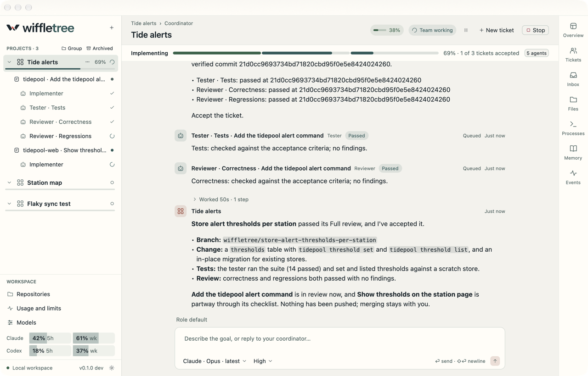
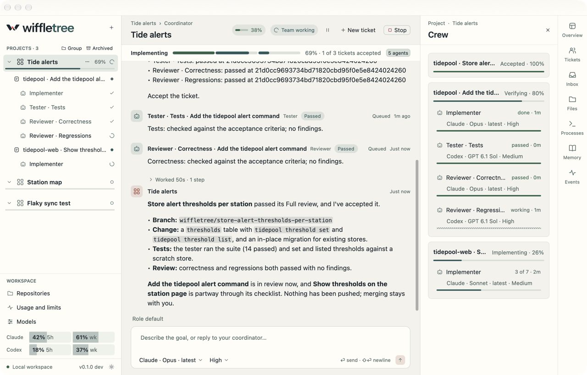
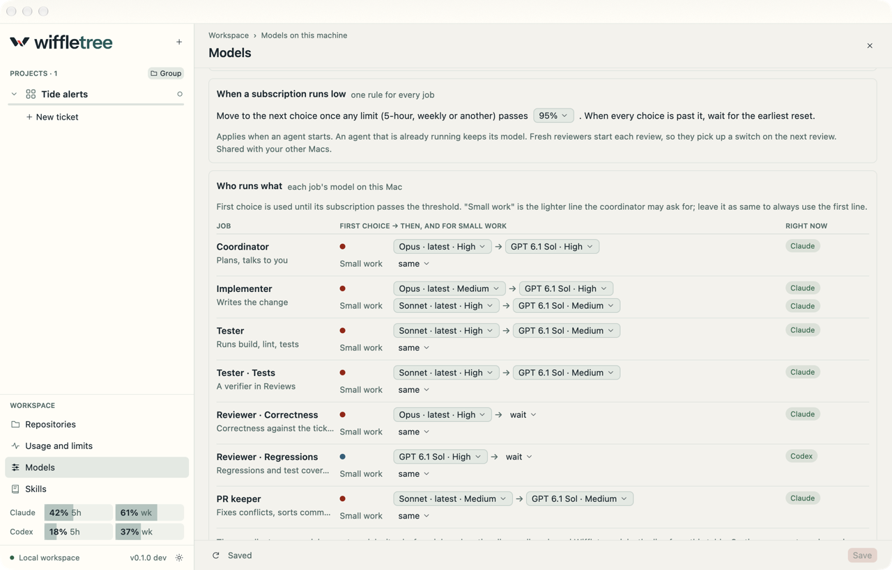
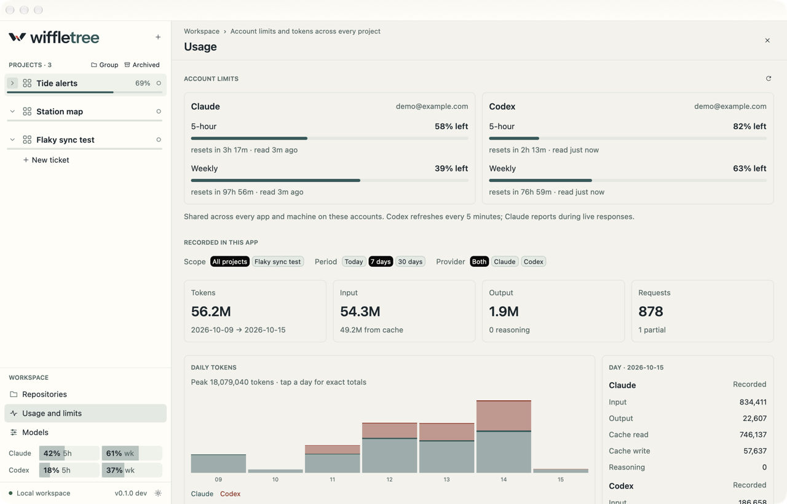
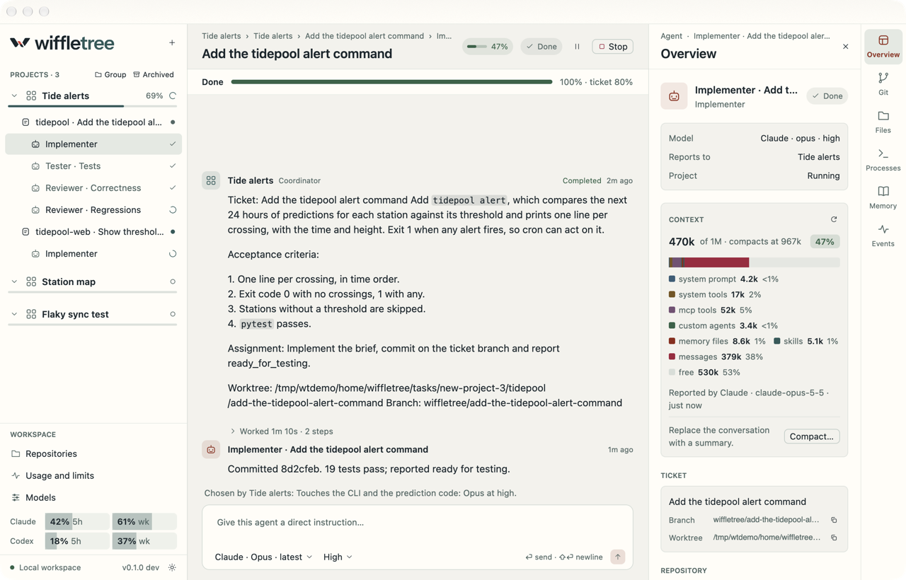

<p align="center">
  
</p>

<p align="center">
  <strong>A native Mac workspace where Claude and Codex agents work as a team.</strong><br>
  Give one coordinator a goal. It plans the work, staffs each repository, and reports back with tested branches.
</p>

<p align="center">
  <a href="https://github.com/Vyttle-LLC/wiffletree/releases/latest"></a>
  
  <a href="LICENSE"></a>
</p>



<table>
  <tr>
    <td width="50%"></td>
    <td width="50%"></td>
  </tr>
  <tr>
    <td align="center"><sub>Every ticket gets its own branch, implementer and independent reviewers.</sub></td>
    <td align="center"><sub>You decide who runs each job, and what happens when a subscription runs low.</sub></td>
  </tr>
  <tr>
    <td width="50%"></td>
    <td width="50%"></td>
  </tr>
  <tr>
    <td align="center"><sub>Account limits from the providers, above the tokens your agents used each day.</sub></td>
    <td align="center"><sub>See what fills an agent's context, and compact it when you choose.</sub></td>
  </tr>
</table>

## Install

Wiffletree runs on Apple Silicon Macs with macOS 13 or later. Install the latest release with one command:

```sh
curl -fsSL https://raw.githubusercontent.com/Vyttle-LLC/wiffletree/main/scripts/install.sh | bash
```

The script downloads the signed and notarized app from [Releases](https://github.com/Vyttle-LLC/wiffletree/releases/latest), checks it with Gatekeeper, moves it to `/Applications` and opens it. Run it again any time to reinstall. To install somewhere else, set `WIFFLETREE_INSTALL_DIR=~/Applications`. If you prefer to do it by hand, download `Wiffletree-<version>-macos-arm64.zip`, unzip it and drag `Wiffletree.app` to Applications.

Wiffletree drives the agent CLIs you already use, so install [Claude Code](https://code.claude.com), [Codex](https://github.com/openai/codex) or both, and sign in:

```sh
claude auth login
codex login
```

The first time you open Wiffletree, a welcome screen lists the CLIs it found signed in and offers a model setup suggested from them. Review it on the Models page and press **Save**; no agent starts until a setup is saved. Then press **⌘N**, add a repository, and tell the coordinator what you want built. [Your first project](docs/DEVELOPMENT.md#first-project) walks through it step by step.

**Updates are automatic.** The app checks hourly, downloads new versions in the background and shows a card in the sidebar with what changed. Click **Restart to update**, or quit Wiffletree from its menu bar icon. To check right away, click the version number at the bottom of the sidebar.

> [!WARNING]
> Agents run with their provider's permission prompts bypassed so they can work unattended. Add only repositories you are comfortable letting them change. Wiffletree itself pushes a ticket's branch and opens its pull request only through its own checked operation: without asking in repositories whose GitHub owner you allow, and after your approval everywhere else. It never approves, merges, closes or comments on a pull request. If you turn on the PR keeper, Wiffletree also rebases a ticket's open pull request when its base moves and replaces the branch on GitHub, which changes every commit id on the pull request. Agents can still run any command on your Mac, including a push with your credentials, which Wiffletree does not prevent. That includes the PR keeper's model, which gets one try at a conflict or at failed checks when "Try once to fix a conflict or failed checks" is ticked: Wiffletree checks only what the try leaves behind, which files changed and whether your checks command passes, and has that reviewed before pushing it. Your checks command runs as you wrote it.

## Why we built this

Coding agents got good enough that the bottleneck moved. The hard part is no longer getting one agent to write code. It is keeping five of them pointed at the same goal across three repositories, and still knowing what is going on.

The tools we had were terminal managers organized around repositories. They show you a lot, but the work we care about is a feature, a bug or an outcome, and those cut across repositories. Coordination meant pasting text into terminals, so nobody could say for sure whether a message had arrived, been read or been acted on. When something crashed, the plan lived only in our heads.

We wanted to hand off a goal the way you would to a strong team lead, then check in when it mattered. So we built a workspace around that idea instead of around terminals.

## How work gets done

Wiffletree has opinions about how agent work should be organized.

**Projects are outcomes, not repositories.** A project is a feature, a bug or any goal you want reached. Repositories are attached to it, and one repository can serve many projects at once.

**You talk to one coordinator.** Each project has a coordinator that owns the goal and the conversation with you. It plans, asks you the questions that matter and reports the result. You do not have to manage the agents underneath it.

**Each ticket is its own workspace.** The coordinator breaks the work into tickets, one repository each, with its own branch and worktree. It assigns an implementer, then verifies with one call that runs every tester and reviewer in the chosen review level at once on the same commit, and accepts the result.

**Tickets are small, isolated and tested by someone else.** Every ticket gets its own Git worktree and branch. An implementer builds it, and a separate tester checks it against the acceptance criteria. "The turn ended" never counts as "it works."

**You decide how thorough a review is.** A review level is a named set of testers and reviewers, with a line telling the coordinator when to use it. A full review can be a ticket's only review. A re-check, such as the suggested "Light", runs only on a ticket whose last review passed, for example after a rebase or a small fix. You also cap the rounds in one review and the full reviews per ticket.

**Blocked is not the same as needs-you.** Workers report blockers to the coordinator, which resolves most of them. Only the coordinator escalates to you, and it gathers its questions in one Inbox so you answer them once.

**Any model can play any role, and you decide who runs what.** Claude can coordinate Codex implementers, and Codex can coordinate Claude. On the Models page, one table says who runs each job (the coordinator, implementers, testers, each reviewer and the PR keeper): a first choice, a choice for when that subscription runs low, and optionally a lighter line for small work. Wiffletree moves a job to its next choice when the first choice's subscription passes a threshold you set, 95% by default, and when every choice is past it, waits for the earliest reset; it never buys more. A reviewer's row can say skip instead, and then a review goes ahead without that reviewer and says so. By default the Claude and Codex reviewers wait rather than switch, so a second opinion stays a second opinion. The coordinator never picks models: it asks for a job, and for small work when it fits, and each agent shows why it runs where it does, just above the message box, such as "Started on Codex: Claude's weekly limit was at 96%". A running agent never switches provider. You can still change the model of any single agent yourself.

**You can change how agents work, not what they may do.** The Skills page, after Models in the sidebar, lists four skills: Coordinating, Implementing, Reviewing and Keeping a PR. Each is a stock text bundled with Wiffletree, and you can add your own rules after it. Agents are told that your rules win where the two disagree. A saved change applies from each agent's next turn. A Codex agent gets it from its next new session, because a resumed Codex session keeps the instructions it started with. You can also rewrite the stock text itself, after a confirmation: your rewrite is sent in place of it. When a release brings a new version of a skill you rewrote, Wiffletree merges the update into your rewrite on its own, paragraph by paragraph, and leaves a note on the skill's page with Review changes, which shows each change before and after, and Undo, which puts back exactly what you had. Where you also changed a passage the update changes, the PR keeper's Claude model merges just that passage; with no such model, you choose the update's wording or yours on the skill's page. You are asked only when the model finds that the two wordings want different things: the question waits at the top of every project's Inbox and on the skill's page, and answering it on one Mac settles it on all of them. With a settings repository, one Mac merges for all of them. Until a merge applies, your rewrite keeps running as written, and the skill is marked out of date, with a dot on the Skills row and what changed line by line; you can merge it in, mark it up to date or reset it. Reset to stock removes your rules or rewrite after asking, and a skill's History lists every change, newest first, with View and Restore, so nothing you wrote is lost. Every agent also gets a fixed core that you can read there but not edit: its workspace tools, how it reports, and the rules the app enforces whatever a skill says. Each skill's page lists what the app enforces and what the text decides. Authority is not in the text. An agent's shell is not sandboxed, so it can still run `git push` with your credentials, and it can write the skills folder in the data folder, as it can write the settings file.

**Your settings can follow you to every Mac.** In Settings, name a private GitHub repository that you created, empty or already used by your other Mac. Wiffletree then keeps the skills with your rules, rewrites and their history, the review settings, the model notes, the switch threshold, the check-in thresholds and the PR keeper's triggers the same on every Mac that names it. It pulls at launch and every 5 minutes and pushes a few seconds after you change something, with no model. What belongs to one Mac stays there: who runs each job, the PR keeper's model included, the workspace folder, the owners allowed to get pull requests, the repositories and their checks, and the appearance. Passwords, tokens, the database, conversations, projects and tickets are never shared. Choosing the repository on a Mac is what lets Wiffletree push to it, only to its default branch, only its own files and never by force; the owners you allow for pull requests neither grant nor need that. Skills are part of every agent's instructions, so whoever can push to the repository can change how your agents work on every Mac, and an organization's members may be able to read a private repository it owns: Settings says who can before you choose. When two Macs change the same setting, or something other than Wiffletree changes one, that setting pauses until you choose, with a note at the top of every project's Inbox and a comparison of both versions. An agent's shell can still write the shared folder and push to the repository with your credentials. Sync does not prevent that, but it does not spread an edit it did not make: such an edit waits for you on that Mac.

**Messages are durable.** Agents talk through the app's message queue, not by typing into each other's terminals. Every message is saved before it is acknowledged, and an idle recipient wakes the moment one arrives. After a restart, each agent resumes its exact provider session, and the app never silently retries work that might have had side effects.

**Software does the routine work; models do the thinking.** Git state, status, polling and usage tracking are ordinary deterministic code. Models are woken only for decisions that need reasoning, so coordinators sleep between events instead of polling.

**You can see how far along the work is.** The app derives the progress bars from each agent's checklist, each ticket's stage and its review results. The coordinator's strip shows the project's phase, one segment per ticket and how many tickets are accepted. The Agents panel, opened from any of the project's conversations, lists every ticket with its agents, their models and their progress, and marks an agent that is stuck.

**You can see what fills an agent's context.** Each agent's Overview has a Context card that shows how full its context window is and with what, measured after every turn without a model call. Claude reports its own categories; for Codex they are estimates. **Compact…** on the same card replaces a Claude or Codex agent's conversation with a summary when you choose, and for Claude you can say what to keep.

**You can stop what agents leave running.** A dev server or watcher an agent starts keeps running between its turns. The Processes panel lists what each agent has running, or every agent's from the coordinator, with how long it has run and its CPU, and stops one or all of them. Wiffletree also stops them when an agent is stopped or archived and when the app quits.

**Usage and limits stay in view.** The sidebar shows each provider's 5-hour and weekly limits, and the Usage page puts both accounts side by side. Those percentages come only from the providers' own telemetry: the Codex app server, and the rate-limit events Claude sends during live turns, so a Claude window reads **Unavailable** when Claude reports no percentage. Wiffletree never scrapes account pages or spends tokens to check. Below the limits, it charts the tokens its agents used by day and ranks them by coordinator, with project and provider filters.

**Humans own integration.** Agents deliver tested branches. Once a ticket's review has ended, Wiffletree pushes its branch and opens its pull request itself: without asking for the GitHub owners you allow on the Repositories page, and only after you approve each step everywhere else. It never approves, merges, closes or comments on a pull request, so merging stays yours.

**The PR keeper keeps pull requests current, if you ask it to.** It is off until you tick "Keep it rebased" on the Repositories page, and it acts only in repositories that open pull requests without asking. Once a pull request's base has been quiet for a couple of minutes, Wiffletree rebases the branch itself, with no model and no review, and replaces the branch on GitHub with a lease, only when the rebased change is the same as the reviewed one. Every commit id on the pull request changes. A rebase whose patch changed, because the base moved lines the change touches, is pushed only with "Try once to fix a conflict or failed checks" ticked, a re-check level chosen for it and a checks command on the repository's row: the command, such as `cargo test`, runs on the rebased commit, stopped after its limit (20 minutes unless you set 1–120), then the commit is reviewed at that level before it is pushed. If either fails, nothing is pushed, the branch is left as it was before the rebase and the coordinator is told. A rebase that conflicts gets one try by the PR keeper's model at each pull request head, with the same settings and a PR keeper model in Models → Who runs what. The model works in the keeper's own checkout, never the ticket's worktree, and its result is thrown away unless it changes only the files Git could not merge, passes the checks and passes the review; only then is it pushed. A try that is thrown away leaves the branch and the ticket's review as they were, and the coordinator is told why. The pull request's line reads "keeper resolving" while the try runs and "with the coordinator" after one was thrown away. The same setting covers failed checks: a pull request whose checks failed on GitHub gets one try the same way, once no rebase is due for it: Wiffletree first runs your checks command on its head, and if it passes here, no model runs and the coordinator is told the failure could not be reproduced. Otherwise the model's fix must add commits on top of the head, change only files the pull request already changes and pass the same checks and review; the line reads "keeper fixing" meanwhile. Without all of these, a changed patch, a conflict or failed checks are left to the coordinator. With "Sort new comments" ticked and a Claude model in the PR keeper's row, it also sorts new comments from people who can push to the repository into needs a change, a question or no action, with a model run that has every tool and hook turned off, and sends the coordinator links to those that need something, never their text. It never replies, resolves or reacts on GitHub. It works only while Wiffletree is running.

**It should feel instant.** Wiffletree is a native Rust app built on [GPUI](https://github.com/zed-industries/zed/tree/main/crates/gpui), not a web view, and it stays light when idle.

## Status

Wiffletree is early software, and it changes quickly. Live Claude and Codex runs, exact session resume and mixed-provider handoffs work today. Everything runs on your Mac. Agents keep working after you quit the app, and a menu bar icon shows how many are; they stop when the Mac restarts or you log out, until you open Wiffletree again. See [current limits](docs/DEVELOPMENT.md#current-limits) and the [product requirements](docs/PRD.md) for what comes next, including a headless host you can drive from another machine.

## Build from source

You need macOS on Apple Silicon, a recent stable Rust toolchain and Xcode with its Metal toolchain.

```sh
bash scripts/package_macos.sh
open target/Wiffletree.app
```

Use `--beta` to build a separate **Wiffletree Beta** that runs beside the installed app with its own store. To try it against a scratch store without packaging:

```sh
cargo build --locked --release -p workspace-host -p workspace-desktop
./target/release/workspace-desktop \
  --data-dir /tmp/wiffletree-preview --demo-repository "$PWD"
```

On a fresh store, save the suggested setup on the Models page and relaunch to get the demo project.

[Development notes](docs/DEVELOPMENT.md) cover model configuration, headless commands, validation and releases. [Measured host timings](docs/performance/host-baseline.md) are kept separate from the desktop and provider performance targets, which are not yet verified.

## Contributing

Contributions are welcome. Start with [CONTRIBUTING.md](CONTRIBUTING.md) for the workflow and the checks every pull request must pass. For anything larger than a small fix, open an issue first so we can agree on the approach.

Useful places to start reading:

- [Product requirements](docs/PRD.md): the source of truth for scope, architecture and performance budgets.
- [Design guide](design/README.md): the current interactive mockup, earlier studies and their limits.
- [Brand kit](design/brand/README.md) and [colors](design/brand.md): the Interlock mark and the Tidal palette.

To report a vulnerability, follow [SECURITY.md](SECURITY.md) instead of opening a public issue.

## License

Wiffletree is released under the [MIT License](LICENSE). The bundled Instrument Sans subset used for the wordmark is under the [SIL Open Font License](design/brand/source/OFL.txt).
