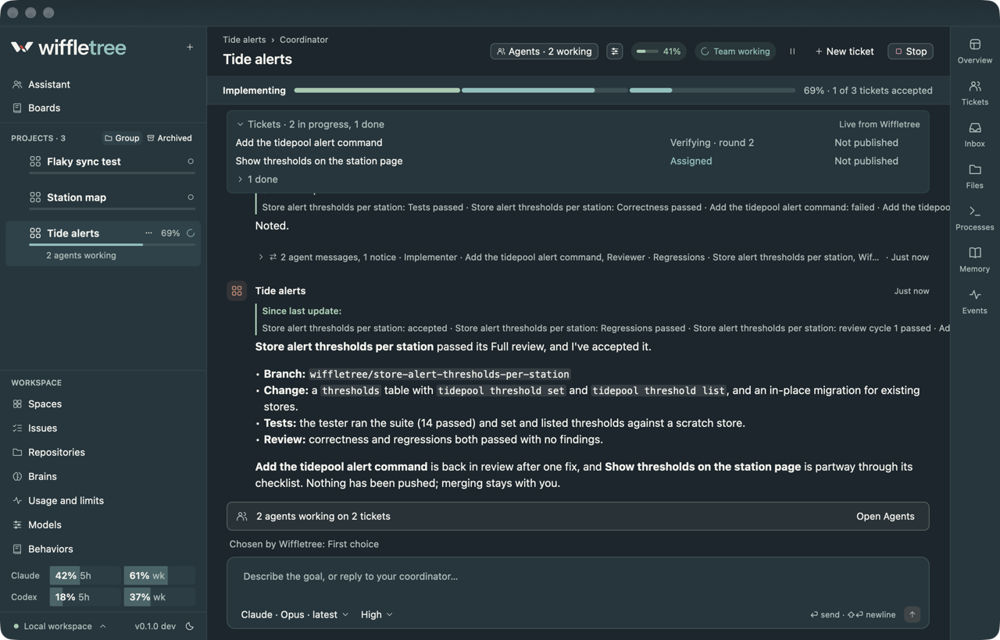
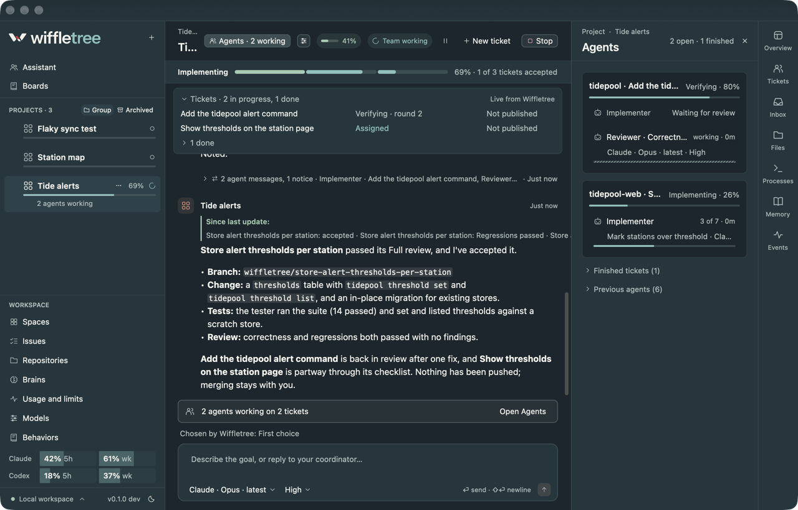
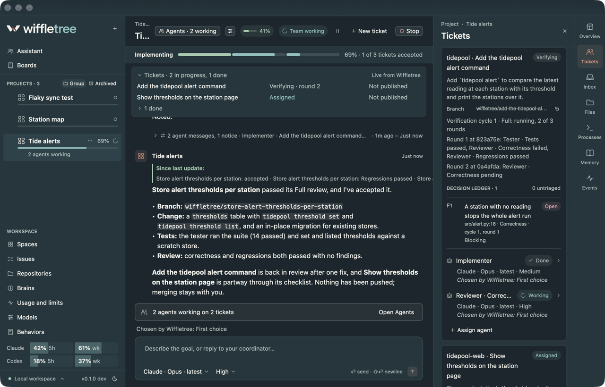
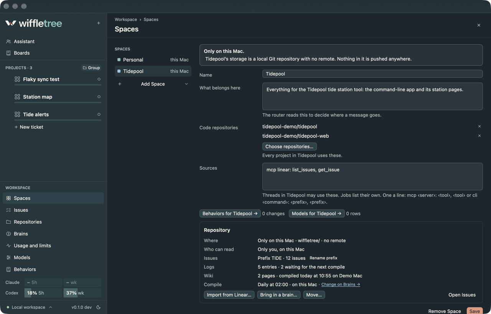
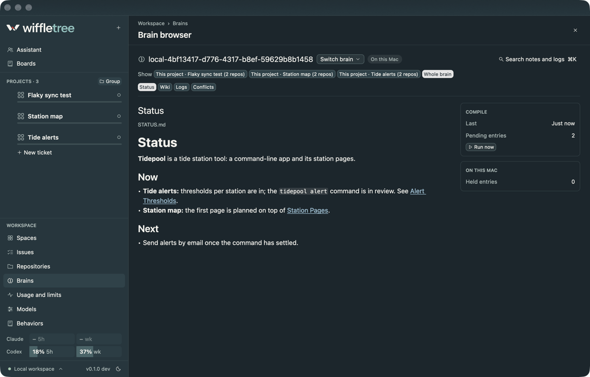
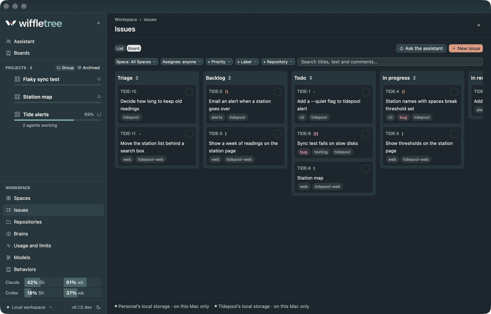
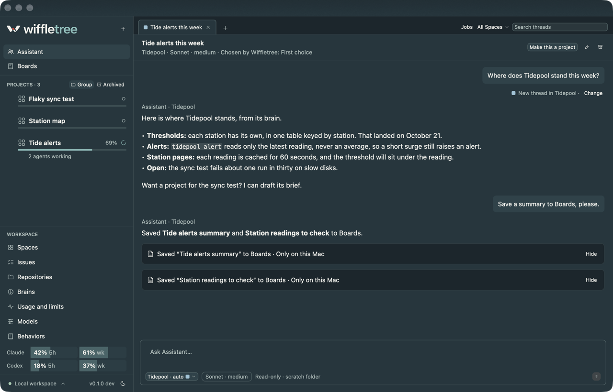
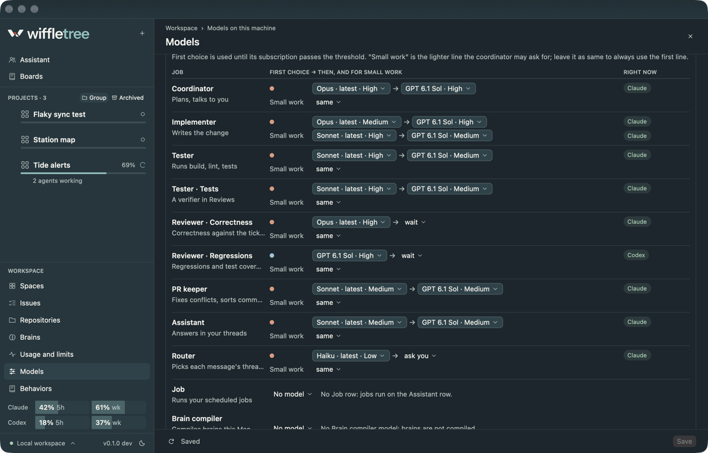
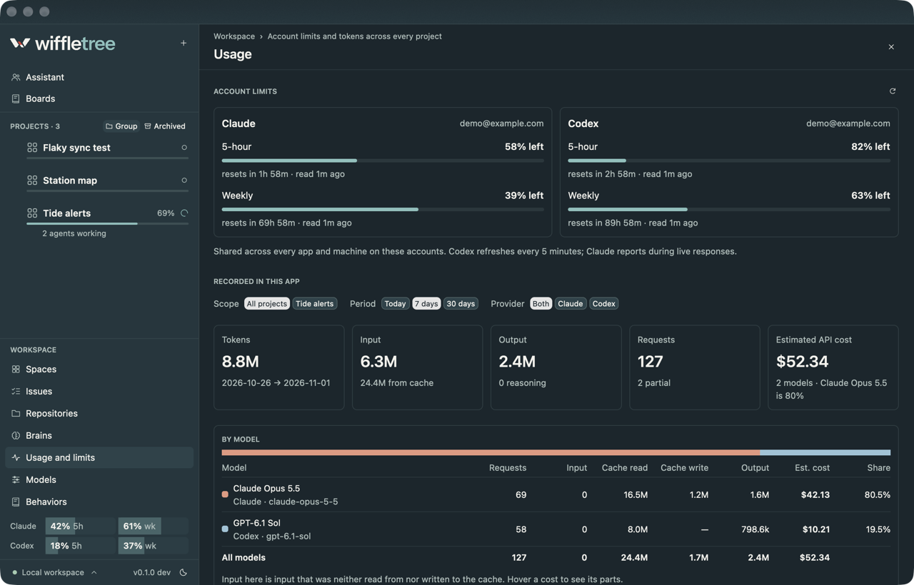

<p align="center">
  
</p>

<p align="center">
  <strong>A native Mac workspace where Claude and Codex agents work as a team.</strong><br>
  Give one coordinator a goal. It plans the work, staffs each repository, and reports back with tested branches.
</p>

<p align="center">
  <a href="https://github.com/Vyttle-LLC/wiffletree/releases/latest"></a>
  
  <a href="LICENSE"></a>
</p>



## What it is

- **One goal, one coordinator.** You describe an outcome, and a coordinator plans it, staffs it and reports back.
- **A team of agents.** Claude and Codex play any role, and you choose who runs what.
- **Tested branches.** Someone other than the author checks every ticket before it is accepted.
- **Memory that lasts.** A Space can keep a second brain, a Git repository of what your team decided and learned.
- **Why we built it.** The hard part moved from writing code to keeping several agents on one goal, and that work cuts across repositories.

The full explanation of everything below is in **[docs/FEATURES.md](docs/FEATURES.md)**.

## Install

- You need an Apple Silicon Mac with macOS 13 or later. Install the latest signed release with one command:

  ```sh
  curl -fsSL https://raw.githubusercontent.com/Vyttle-LLC/wiffletree/main/scripts/install.sh | bash
  ```

- Run it again to reinstall, or set `WIFFLETREE_INSTALL_DIR=~/Applications` to install elsewhere. [Releases](https://github.com/Vyttle-LLC/wiffletree/releases/latest) has the zip.
- Install [Claude Code](https://code.claude.com), [Codex](https://github.com/openai/codex) or both, and sign in:

  ```sh
  claude auth login
  codex login
  ```

- On first run, review the suggested setup on the Models page and press **Save**. No agent starts until a setup is saved.
- Press **⌘N**, add a repository, and tell the coordinator what you want. See [your first project](docs/DEVELOPMENT.md#first-project).
- Updates are automatic: a sidebar card offers **Restart to update**.

## Features

<table>
  <tr>
    <td></td>
    <td></td>
  </tr>
  <tr>
    <td align="center"><sub>Every ticket shows its agents and progress.</sub></td>
    <td align="center"><sub>Reviews keep each round and finding.</sub></td>
  </tr>
  <tr>
    <td></td>
    <td></td>
  </tr>
  <tr>
    <td align="center"><sub>A Space holds a brain, repositories and rules.</sub></td>
    <td align="center"><sub>The brain browser reads a second brain.</sub></td>
  </tr>
  <tr>
    <td></td>
    <td></td>
  </tr>
  <tr>
    <td align="center"><sub>Issues are plain files in your repository.</sub></td>
    <td align="center"><sub>The Assistant answers in read-only threads.</sub></td>
  </tr>
  <tr>
    <td></td>
    <td></td>
  </tr>
  <tr>
    <td align="center"><sub>You decide who runs each job.</sub></td>
    <td align="center"><sub>Limits sit above what your agents used.</sub></td>
  </tr>
</table>

### Projects and the coordinator

- A project is an outcome, such as a feature or a bug, not a repository.
- Each project has one coordinator, which plans, asks what matters and reports the result.
- Workers report blockers to the coordinator. Only it escalates to you, through one Inbox.

[More on projects](docs/FEATURES.md#projects-and-the-coordinator)

### Tickets

- Each ticket has one repository, its own branch and its own worktree.
- An implementer builds it and separate agents check it. "The turn ended" never counts as "it works."
- Agents talk through a durable message queue, and each resumes its exact session after a restart.

[More on tickets](docs/FEATURES.md#tickets)

### Reviews

- A review level is a named set of testers and reviewers, called verifiers.
- A full review can be a ticket's only review. A re-check, such as "Light", runs only after a review that passed.
- All verifiers run at once on one commit, and only those that failed check again.
- Findings need a location, a trigger and evidence, and they stay in the ticket's decision ledger.
- You cap the rounds in a review and the full reviews per ticket.

[More on reviews](docs/FEATURES.md#reviews)

### Spaces

- A Space answers "where does this go?" for projects, threads, jobs and issues.
- It holds a brain, code repositories, instructions for every role and its own model rows.
- A new Space is local and never pushed. To share one, store it in a private GitHub repository.
- Only you create and edit Spaces. No agent tool can.

[More on Spaces](docs/FEATURES.md#spaces)

### Second brain

- **Logging:** agents record decisions as they work, and entries reach the brain in batched pull requests.
- **Reading:** agents ask with `query_brain`, and you use the brain browser's Status, Wiki, Logs and Conflicts views or ⌘K.
- **Compile:** one Mac folds entries into notes on a schedule, and conflicts come to you as Inbox cards.
- **The brain gate:** seven deterministic checks guard `main`, including secret and personal-data scans.

[More on the second brain](docs/FEATURES.md#second-brain)

### Issues

- The Issues page shows every Space's issues as a list or a board.
- Each issue is plain files in its Space's storage repository, and it stays in Git history for good.
- Start a project from an issue, import from Linear, or let the assistant suggest changes for you to apply.

[More on issues](docs/FEATURES.md#issues)

### Assistant, recurring jobs and Boards

- The assistant takes quick questions in threads, and a router picks each message's thread and Space.
- A thread is read-only plus a scratch folder, and it stays on your Mac.
- Recurring work is a job only you can save, and Boards keeps what threads and jobs produce.

[More on the assistant](docs/FEATURES.md#assistant-recurring-jobs-and-boards)

### Models and usage

- Any model can play any role, and the Who runs what table sets each job's choices.
- A job moves on when a limit passes your threshold, 95% by default. Wiffletree never buys more.
- Limits come only from the providers' own telemetry, and the Usage page charts tokens by day.
- Each agent's Context card shows what fills its context, with **Compact…** beside it.

[More on models and usage](docs/FEATURES.md#models-and-usage)

### Behaviors and skills

- The Behaviors page changes how agents work at the Workspace, a Space or a repository.
- Five skills hold each role's instructions. You can add rules or rewrite them and still get updates.
- Every agent also has a fixed core you can read but not edit.

[More on Behaviors](docs/FEATURES.md#behaviors-and-skills)

### Pull requests

- **Publishing:** Wiffletree pushes a reviewed ticket and opens its pull request.
- **Protected branches:** each repository lists them, and Wiffletree refuses to merge into one.
- **Merging:** it merges into other branches only at the reviewed commit, when the coordinator asks.
- **The PR keeper:** an opt-in helper rebases pull requests and tries once to fix a conflict or failed checks.

[More on pull requests](docs/FEATURES.md#pull-requests)

### Also included

- **[Settings sync](docs/FEATURES.md#settings-sync):** a private GitHub repository keeps your skills and review settings on every Mac.
- **[Remote access](docs/FEATURES.md#remote-access):** pair another Mac to drive this one. It is off by default.
- **[Processes panel](docs/FEATURES.md#processes-panel):** see and stop the dev servers agents leave running.

> [!WARNING]
> Read this before you add a repository. The [full text](docs/FEATURES.md#safety) gives every condition.
>
> - **Permission prompts are bypassed,** so add only repositories you are comfortable letting agents change.
> - **Agents can run any command on your Mac with your credentials,** including a push or a merge. Wiffletree does not prevent that.
> - **Wiffletree pushes and opens pull requests itself:** without asking for owners you allow, and after your approval elsewhere.
> - **It merges through its checked merge,** when the coordinator asks, for allowed owners, and never into a protected branch.
> - **Brain branches auto-merge.** It pushes `wiffletree/brain/` branches, and GitHub merges each once the gate passes, except Set up's and Update gate's.
> - **The PR keeper, if you turn it on, rewrites branches,** which changes every commit id on a pull request.
> - **The PR keeper's model gets one try** at a conflict or failed checks, and only what it leaves behind is checked.
> - **Your checks command runs as you wrote it.**

## Status

- Wiffletree is early software, and it changes quickly.
- Live Claude and Codex runs, exact session resume and mixed-provider handoffs work today.
- Everything runs on your Mac, and another Mac can drive it with [remote access](docs/FEATURES.md#remote-access).
- Agents keep working after you quit the app. They stop when the Mac restarts or you log out, until you open Wiffletree again.
- See [current limits](docs/DEVELOPMENT.md#current-limits) and the [product requirements](docs/PRD.md) for what comes next, including an iPhone client.

## Build from source

You need macOS on Apple Silicon, a recent stable Rust toolchain and Xcode with its Metal toolchain.

```sh
bash scripts/package_macos.sh
open target/Wiffletree.app
```

- Use `--beta` to build a separate **Wiffletree Beta** with its own store.
- To try a scratch store without packaging, then save the suggested setup and relaunch to get the demo project:

  ```sh
  cargo build --locked --release -p workspace-host -p workspace-desktop
  ./target/release/workspace-desktop \
    --data-dir /tmp/wiffletree-preview --demo-repository "$PWD"
  ```

- [Development notes](docs/DEVELOPMENT.md) cover configuration, headless commands, validation and releases.
- [Measured host timings](docs/performance/host-baseline.md) are separate from the performance targets, which are not yet verified.

## Contributing

- Start with [CONTRIBUTING.md](CONTRIBUTING.md). For anything larger than a small fix, open an issue first.
- To report a vulnerability, follow [SECURITY.md](SECURITY.md) instead of opening a public issue.
- Useful reading: [features](docs/FEATURES.md), [product requirements](docs/PRD.md), the [design guide](design/README.md), the [brand kit](design/brand/README.md) and [colors](design/brand.md).

## License

Wiffletree is released under the [MIT License](LICENSE). The bundled Instrument Sans subset used for the wordmark is under the [SIL Open Font License](design/brand/source/OFL.txt).
