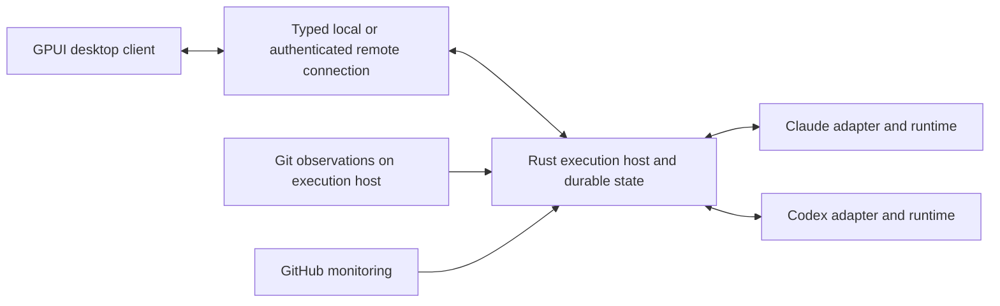

# Wiffletree — Product Requirements

Draft PRD · Updated October 30, 2026 · Product owner: Michael

Build a native desktop workspace for coordinating Claude and Codex sessions across repositories, starting on macOS. Use Rust for the orchestration host and GPUI for the initial client, with Tauri and TypeScript/Svelte as the fallback if the GPUI prototype fails its acceptance criteria. A project is a feature, bug or other outcome. Its coordinator owns the overall goal, the user conversation and its tickets. A ticket is a workspace: one repository, one worktree and branch, and every agent working on it. Implementation, testing and review agents each belong to one ticket and report straight to the coordinator. Michael can inspect and talk to every session directly, while routine coordination stays with orchestrators.

The product must feel immediate, remain inexpensive when idle, and deliver messages reliably. The app owns coordination, persistence, Git state, monitoring, shared Markdown knowledge and scheduled maintenance. Provider runtimes own model execution, tools, and conversation context. No terminal interface is required for the first release.

Rust and GPUI are the selected starting stack; Tauri is the fallback, not a parallel implementation. Detailed architecture choices and performance budgets below remain proposed requirements, not measured results. Wiffletree is the product name, selected October 5, 2026. Tidal is the selected brand palette, with paired light and dark modes. Celadon remains the example project used in the design studies.

## Problem and desired outcome

Existing agent terminal managers provide useful visibility, but organizing primarily around repositories makes cross-repository work harder to follow. Coordinating by injecting text into terminal sessions also makes delivery, interruption, and recovery difficult to reason about.

The desired outcome is one project tree in which each row has a clear owner, conversation, status, and relevant Git state. Michael can delegate a goal, follow progress, inspect a branch graph, address PR feedback, and direct history changes without juggling terminals or losing track of work.

Primary user: Michael, initially working locally on Apple Silicon with several repositories and existing Claude and Codex accounts. The first usable release is a personal, single-user macOS application. Michael can drive one Mac's agents from another paired Mac, and later from an iPhone, without rewriting orchestration. A Linux execution host follows after that. Beside projects, Michael has a personal assistant for quick questions and recurring read-only jobs, organized in Spaces such as Sage, Vyttle and Personal; organizations share Spaces through Git repositories, with every agent still running on each person's own Mac (see [Assistant, Spaces, jobs and Boards](#assistant-spaces-jobs-and-boards)).

## Scope and principles

- macOS first, with a portable Rust host and a client boundary independent of GPUI. Validate the minimum macOS version against GPUI and provider runtimes. Paired Macs can control a Mac host; an iPhone client is next, Linux execution follows, and a Linux graphical client can follow separately.

- Provider choice is independent of role. Claude can coordinate Codex workers, and the reverse must work.

- Each visible agent is an independent session managed by the app. Native provider subagents may be internal helpers, but are not required for orchestration.

- Project orchestrators have no repository or Git branch. Their runtime context lives in app-managed project storage; shared knowledge lives in a team-shared Git brain, the brain of the project's Space (see [Markdown storage and ownership](#markdown-storage-and-ownership)).

- The project coordinator owns work allocation across its tickets directly; there is no intermediate coordinator between it and the agents. Concurrent tickets have isolated worktrees and branches. A ticket's implementer writes alone in its workspace, and its verifiers read it together.

- Keep the interface compact. Load detail on demand instead of rendering every transcript at once.

- Make message and operation state observable. Queued, delivered, acknowledged, and completed mean different things.

- Keep source control and monitoring deterministic. Use models for decisions that require reasoning, not routine polling or status calculation.

Out of scope for the first usable release: remote execution, a Linux graphical client, Windows, managed cloud hosting, multi-user collaboration beyond what organizations share through Git repositories, namely [shared issues](#shared-issues), [team-shared brains](#markdown-storage-and-ownership) and, as planned, Spaces, jobs and outputs (see [Assistant, Spaces, jobs and Boards](#assistant-spaces-jobs-and-boards)), a full code editor, terminal emulation, provider switching within a running conversation, arbitrary workflow scripting, and unrestricted automatic merges. A standalone host on macOS, driven from other paired devices, is the next delivery stage (see [Headless hosts and remote control](#headless-hosts-and-remote-control)); a Linux host follows. The core must have no GUI dependency from the start.

## Project hierarchy and ownership

| Entity | Responsibility | Git workspace |
| --- | --- | --- |
| Space | The home of projects, threads, jobs and issues: instructions, brain, storage repository and tracker, code repositories by `owner/name`, default models and sources; edited only by the human | Its storage repository, one clone per repository under `repos/` |
| Project / coordinator | One feature, bug or outcome; user conversation, planning, cross-repository decisions, tickets, verification and acceptance, and escalation | App-managed project home |
| Ticket / task | Bounded work in one repository the project uses, with acceptance criteria, dependencies and evidence | One isolated worktree and branch for its whole life |
| Implementer, tester or reviewer | One role on one ticket, or one focus when several reviewers share it; resumes for fixes or retests on that same ticket | Uses the ticket workspace; one writer at a time per ticket, while reviewers run together |
| Watcher | Observes Git, GitHub and runtime changes | Ordinary background software |

Every project belongs to exactly one Space, shown in its Overview with Move to another Space, which asks first and changes only where its later log entries go. New project shows the Space, the one last used for a new project, with the brain it logs to, and ticks the workspace repositories whose GitHub name the Space lists; the Space's others are listed as not cloned here, and changing the Space replaces the ticks. Workspace repositories stay a record on each Mac with their clone path, base and checks; a Space lists repositories only by `owner/name`, a repository may be in several Spaces or none, and the Repositories page groups them by Space with one chip per Space, editing the same list as the Space's page.

**Storage.** A Space's storage is a Git repository holding `spaces/<space>/space.yaml`; it is also the Space's tracker, with `issues/` and `wiffletree-issues.yaml` at its root, and every Space stored in one repository shares its issues and prefix. A new Space gets a local repository at `<data folder>/repos/local-<id>/` with no remote, a private tracker that is never pushed. A shared Space lives in a private GitHub repository, cloned once at `<data folder>/repos/github.com/<owner>/<name>/` whatever roles it has on this Mac, and synced by one engine with rules by path: settings and Spaces compare whole files and pause what two Macs, or an edit outside Wiffletree, changed, and the tracker is fetched every minute. Everyone who can read the repository can read the Space and its issues; anyone who can push to it can change the Space's instructions for everyone and edit its issues, and the Space's page says both. Before a push, the host runs the brain gate's `sensitive-info` and `secret-scan` on the changed files under `spaces/`, `issues/` and `wiffletree-issues.yaml` and holds a file that fails, or that a check cannot scan, with a workspace note that never shows the match. Clone paths, allowed models, whether a Space is on and credentials stay on each Mac. The Spaces page in the sidebar's Workspace section is Settings › Spaces: each Space's page edits its definition and shows a Storage and issues box with the repository, the Space's folder, the prefix and issue count, who can read it, the Spaces sharing it, whether it is also the settings repository, where it is on this Mac, its sync and Sync now, and Set up issues for a repository joined without a tracker.

The project is the outcome, the repository is an attachment, and a task is a ticket within the project. Work spanning repositories becomes one ticket per repository, with the shared contract in each brief. Each ticket gets its own workers. The coordinator sleeps without model calls between events and resumes the same provider conversation when needed.

```text
Theme rollout                         Project / coordinator
  frontend · Toolbar styling          Ticket workspace
    Implementer                       One ticket · Codex
    Tester · Claude                   One ticket · Claude
  frontend · Theme initialization     Ticket workspace
    Implementer                       One ticket · Codex
  backend · Palette contract          Ticket workspace
    Implementer                       One ticket · Claude
    Tester · Codex                    One ticket · Codex
```

A coordinator may create another project with the workspace tool `create_project` when the human asks for work that is a separate outcome rather than a ticket of its own project; no other role may. It takes a name, a brief and optionally the repositories the new project uses, otherwise its Space's repositories on this Mac; the new project joins the creating project's Space. The project starts at once, without an Inbox approval, with a coordinator from Who runs what, and appears in the sidebar like any other. Its coordinator's first message is the brief, labelled as Wiffletree's delivery of the creating coordinator's words, naming that coordinator and its project, never as the human's: the new coordinator treats it as context and still plans with the human and asks before creating tickets. The new project records which project and coordinator created it, on the project and in its `project_created` activity. The two coordinators cannot message each other afterwards, but the creating coordinator's `workspace_context` lists the projects it created under `created_projects`, each with its id, name, created time and its tickets as short entries (state, branch and pull request), read only. A typical use: during a review the human asks for a finding to be handled separately, so the coordinator triages it `follow_up`, creates a project for it and, to wait on that work, checks it on a `schedule` timer and continues after its PR merges. Creation is refused before the model setup is saved, for an unknown repository, for a brief longer than the message limit leaves after its source line, and from the coordinator of a project another coordinator's brief started until the human has messaged it, so briefed projects cannot chain without the human; a refusal creates nothing, and each call creates a new project.

A repository may participate in several projects. The app must arbitrate operations across all of them by canonical repository and branch identity. Two sessions cannot independently own the same writable integration branch or worktree. Assignments declare ownership and dependencies before execution.

## Interface requirements

The sidebar lists projects, one row for each coordinator, below the pinned assistant and Boards rows (see [Assistant, Spaces, jobs and Boards](#assistant-spaces-jobs-and-boards)); ticket workspaces, labelled “repository · ticket”, and their agents are listed in the Agents panel. “New project” is the primary creation action and creates the coordinator. A project row's last line sums up its agents, such as “3 agents working”, with a yellow “1 agent stuck” pill when any is stuck, and the row stays selected while the coordinator or any of its agents is open. Conversations belong to coordinator and worker sessions. Compact rows show status glyphs with accessible names and hover detail; PR identity and provider details are available in context without widening every row.

Projects are listed in one manual order that the host stores, so it is the same after a relaunch and for every client. A new project lands at the top, and the user drags projects into any order; a store from before the order existed keeps the newest-first order it was listed in until something is moved. A Group button in the PROJECTS header, left of Archived and on to begin with, shows two or more shown projects whose names share a first word under one group row, placed where the topmost of them is. The first word is the name up to its first space, without trailing punctuation and whatever its case, so “Wiffletree: a” and “wiffletree b” share a group. A row inside a group drops the repeated word; its tooltip, the conversation's title and inline renaming keep the full name. Groups are only a way of drawing the list: nobody creates, renames or deletes one, the host stores none, and renaming a project is how it changes group. A group row collapses from its chevron, and collapsed it shows the most urgent state inside: the needs-you count, else the stuck agents, else blocked, else working. With grouping on, a project is dragged within its own group, and groups and ungrouped projects are dragged among each other, a group taking all its members as one block; with it off, any project is dragged anywhere in the flat list. An insertion line shows where the row lands. The button's state is a view choice saved in `desktop-preferences.json`, where a file without it reads as on, and it never changes the stored order.

Selecting any session, from the sidebar or the Agents panel, opens its conversation. The coordinator is the primary interaction surface, and it stays a conversation rather than a status feed: a table pinned above its transcript shows its tickets in progress, live from Wiffletree's records, and its routine replies say only what is new (see Live work). Worker conversations remain available for optional inspection or intervention; inspecting them is not required to resolve normal orchestration.

Relevant workspace tabs:

- Conversation: durable messages, each turn's final reply, direct messages and permission requests, with the turn's live work shown beside them and other agents' messages folded into activity lines (see Live work).

- Branch history: graphical commit ancestry, local and remote refs, target base, ahead and behind state, selected commits, and history-change proposals.

- Changes: committed and working-tree diffs with file selection.

- Pull request: PR description, head and base, reviews, unresolved threads, comments, checks and merge state.

- Activity: agent messages, operations and watcher events with source and timestamps.

Project-level monitoring summarizes affected repositories and routes attention to the responsible coordinator. Repository selection remains available when a coordinator session is stopped.

Commit selection can become an instruction such as “Squash these fixes into the endpoint commit, then rebase on the feature branch.” The interface shows affected refs, commits, and proposed outcome before a shared-history rewrite. PR links open the corresponding GitHub page. Status must distinguish cached, fresh, stale, and unavailable data.

New project creates a coordinator. New ticket picks one of the repositories the project uses; Assign ticket agent is scoped to the project's tickets. Repositories belong to the workspace. Each project uses every workspace repository by default, including ones added later, or a set the user chooses; once Spaces ship, New project starts with its Space's repositories as the chosen set; a project drops a repository only once none of its open tickets works there. Michael may inspect, message, pause, resume, archive or restore any agent directly. Archiving a session hides it and the sessions it owns, stops scheduling them and preserves their conversations, tickets, branches and history; restoring brings back the session and its owners. Archiving removes the worktrees of the tickets those sessions own, so build output such as `target/` does not accumulate, and restoring re-creates each open ticket's worktree at its saved path from its saved branch. Closing or accepting a ticket also removes its worktree; such tickets take no further agents, so restoring never re-creates them and their branch holds the work. Removal is all or nothing, whatever the folder's size: it refuses, naming each ticket, while any affected worktree is locked or has uncommitted or untracked files (ignored files do not count). The folder is renamed aside, Git forgets it, and the renamed folder is then deleted in the background without a time limit; if Git fails, the folder is renamed back when the worktree is as clean there as it was checked to be, and otherwise the removal completes, since the folder held nothing unsaved. A start deletes any folder a stop left aside and prunes stale registrations. An agent still in its turn, such as a tester writing its summary after reporting, does not block: the state change happens at once and the removal is recorded as pending, then performed when the ticket's last turn ends or the service starts. Archiving, closing and accepting first stop every process the affected agents started (see Reliability and control), so nothing runs in a worktree as it is removed. A process the host could not confirm as the agent's is not signalled, and its agent still counts as in its turn until that process group exits or the human dismisses its inbox note. The next start tries again; a worktree removal itself only probes the group and never signals it. Only removals recorded this way are ever performed later; restoring cancels them. If the worktree gained unsaved work by then, or Git cannot remove it, it is kept and the nearest unarchived owner of the ticket is told once, or the human through the inbox when the whole project is archived. If a removal or the recorded change still fails, the removed worktrees are re-created from their branches. A missing ticket branch fails the restore and names the ticket. Archive never deletes branches or conversations. The coordinator sees each ticket with its repository, agents and verification record. Accepting or closing a ticket archives its agents; nothing else archives an open ticket's implementer, so a ticket that ships as a PR is accepted after the PR merges. The coordinator retires agents it no longer needs, such as a reviewer whose findings reached the implementer, with `archive_agent`, which refuses an agent mid-turn, an open ticket's implementer and a verifier its running cycle still needs. Direct instructions are visible to the coordinator. Repository coordinators from older stores are migrated: their tickets and agents move under the project coordinator and they stay archived, readable and not restorable.

### UI layout exploration

The current interactive direction uses the Tidal palette with Chat as the default workspace. The conversation fills the available width beside a compact list of projects, whose tickets and agents open in the Agents panel. Files, Overview, Git history, changes, PR feedback, Memory, scheduled work, usage and activity open only when requested in a contextual side panel. Brains have their own workspace page; a project's Memory panel summarizes its brain and opens that page. The composer supports attachments and scope selection. Enter submits the draft; Shift Enter inserts a newline. Context panels preserve the conversation and draft; closing them restores the full chat width.

Project/team navigation lives in a compact inspector rail at the right edge of the workspace. It follows the selected conversation and opens an adjacent, resizable inspector whose header names the scope and owner. Projects expose Overview, Tickets, Inbox, Memory and Events; the Tickets inspector lists each ticket with its repository, state, agents and verification rounds. The coordinator's conversation also pins a ticket table above its transcript, filled from the same records and never written by the model: each ticket in progress, meaning open and not planned or with an open PR, with its title, its state in the inspector's words with the round while a review runs, such as "Verifying · round 2", and its PR's number and state linked to GitHub, or "Not published". Accepted and closed tickets collapse to one "N done" line that opens to list them; backlog items such as shared issues never appear. The table collapses to its title line, a choice kept in `desktop-preferences.json`, and it redraws from the snapshot the client already reloads, so it stays current without a coordinator turn and polls nothing. Workers omit human Inbox; the Inbox entry shows the count of open decisions. Every session has a Processes entry beside Files, which carries the count of processes its agents have left running and no count when nothing runs. On an agent the Processes panel lists that agent's process groups; on the coordinator it lists every agent of the project, grouped by agent, with "Nothing running." for agents without any. Each row is one process group: its programs, "8 processes · started 14:27 · group 43477", how long it has run, its CPU summed over the group as a percentage of one core, highlighted at a full core or more, and Stop; one agent's panel also has Stop all. Counts come first in words and programs are named as programs, never as a name beside a bare count. Running time and CPU are read once a second while the panel is open and never while it is closed. A group whose recorded processes are gone but that still runs is shown as one Wiffletree cannot confirm and has no Stop. Stopping from the panel stops only the processes: the agent keeps working and reads at its next turn what was stopped. The rail holds only what belongs to the selected session, including its context window. Information about the whole workspace, namely account limits, recorded usage and who runs each job, opens as full pages from a Workspace section in the sidebar and always covers both providers. A project needs no step to go live: a human message, a retry or an answered decision starts it, and Stop interrupts it. Shared project memory and the workspace-wide Who runs what table are explicitly identified within their views. Closing the inspector restores conversation width while the rail remains available.

A ticket may stack on another ticket of the same project and repository that is not closed, for work that depends on it. `create_ticket` takes the parent's id as `stack_on`; the ticket records it as `stacked_on`, which `workspace_context` and the ticket's cards show. Its branch starts at the parent's branch tip, and it is measured against that branch: the reviewers' base and diff, the size a publish reports, and the patch comparison behind accepting, publishing and the PR keeper. A rebase of the whole stack, which changes the parent's commits, therefore needs a new review of the child. Its pull request opens into the parent's branch, so `publish_ticket` refuses until the host has pushed the parent; once the parent's pull request has merged, the child's opens into the parent's base: the parent's own `base` if it has one, otherwise the repository's base. The PR keeper rebases a stacked PR onto its parent's branch, never onto main. Stacks across repositories, and retargeting an open pull request after its parent merges, are not supported.

New project opens a dialog: choose the Space, defaulting to the one last used and naming the brain the project logs to, the name, the repositories, with the Space's ticked, and an optional first message, then Create project. The project and its coordinator are created and selected, and the first message, if any, goes to the coordinator. Project names can be edited later by double-clicking their row or using its rename button. Renaming preserves the project ID, storage path and conversation. Other creation actions open focused dialogs: New ticket selects one of the project's repositories and captures its brief and acceptance criteria; Assign ticket agent selects a ticket and role; Add repositories is reachable from the workspace Repositories page, the project's sidebar menu and its Overview, and opens first when a ticket is created in a project without repositories. Adding from a project that chose its own set also includes the new repositories in it. Choose repositories in the Overview switches a project between every workspace repository and a chosen set. Parent folders are remembered as root folders and rechecked on launch, window activation (rate-limited) and opening the Repositories page, off the host thread and with read-only Git only for unknown folders; new repositories join the workspace, while linked worktrees, empty repositories and anything the user unticked or removed stay out. Missing folders are flagged, not deleted. It accepts repository roots and multiple parent folders (such as ~/dev/* and ~/dev/company/*), rescans immediate children for Git roots as each is added, and lets the user select which repositories to attach to the current project. Attaching one repository with a custom base ref has its own form. An inferred base prefers origin: origin/HEAD, then origin/main and origin/master, before local main, master and HEAD; a rescan or re-import never changes a saved base. Each repository row on the Repositories page edits its base in place: Enter saves once the ref resolves to a commit, Escape cancels, and a refused ref stays in the editor with why. The change rebases, pushes and publishes nothing. Show full paths, inferred bases, already-attached repositories and scan/import failures. Repository selection controls have readable heights and searchable menus; dialogs remain usable within the window bounds. Keep validation errors and entered values in the dialog until the host confirms success. Report other request outcomes as transient notifications rather than a persistent status line. Explain idle states where the user is looking: queued messages on a stopped project, held input and pending decisions each appear as a notice above the composer with their resolving action. A pending-decision card can be minimized to one row and restored; the choice is kept per project in memory and cleared once the project has no open decision. A long pending-decision card is capped at about half the window's height and scrolls between its header and its buttons, which stay visible with the composer. Both hierarchy and inspector panes have draggable dividers. The native typography baseline uses the macOS system family: 13 px chrome, 14 px conversation text with generous line height, 18 px semibold conversation/inspector titles, and 10–12 px metadata. Use quiet separators, original bundled line icons and warm accent color sparingly.

Status glyphs distinguish Working (spinning arc), Blocked (minus circle), Done (check) and Paused. Only Working has color; the others stay muted so the tree shows at a glance what is moving and what needs someone. An idle coordinator shows Working while any agent beneath it works, so a quiet parent never hides activity; its own Blocked or Paused state is not masked, and the tooltip names the roll-up. Only the main project orchestrator carries Needs you: a solid warning-colored badge with a question mark and the count of open questions and approvals, which takes the place of the project's status glyph. Warning color is reserved for this signal and for one extreme case, the project row's “N agents stuck” pill. Selection is shown by the row background, not by tinting its icon. A blocked worker reports to the project coordinator, which resolves the issue within its authority or asks the human. Routine completions and blockers update the UI and owning coordinator without creating competing human notifications. The project orchestrator consolidates unresolved questions and required approvals into its conversation and inbox. Permission requests retain the originating agent, host and exact operation; orchestration never bypasses required human approval. Done describes the assignment, not PR merge state. Git selections and reviewer threads can still become scoped instructions without displacing chat.

The references inform a layered workspace with a quiet atmospheric background, sculptural project artwork, editorial headings and precise, compact controls. The product name is Wiffletree. Tidal is the selected color direction: deep teal, stone, and rust, adapted for both appearances. See the [brand color guide](../design/brand.md) and [canonical theme tokens](../design/themes/wiffletree-tidal.json). The selected identity pairs a red Interlock open-joint symbol with a lowercase, two-tone Instrument Sans wordmark; the brand kit defines its light and dark variants. Use static gradients and opaque content surfaces to create depth; the design must not require live backdrop blur, looping animation or rendering every agent view.

The embedded prototype uses simulated sessions, Git history, PRs, usage and maintenance jobs. Its main interactions include agent selection, separate drafts, queued chat messages, commit selection and history instructions, PR feedback, scoped test approval, task creation, sourced brain notes, conflict rulings and scheduled-job controls. Theme switching preserves the current draft and commit selection. These interactions change demo state only; no provider, GitHub or execution-host operation is performed. The prototype demonstrates design and behavior, not a working Rust/GPUI implementation or measured native performance.

[Open the current interactive mockup](../design/mockups/current/index.html) · [Editable source](../design/mockups/current/source.html)

### Live work

The conversation keeps durable messages and each turn's final reply. An agent's in-progress work, meaning narration between tool calls, commands, file edits, reads, searches, plans and tool calls, is shown as work steps beside it and never as chat messages. Both providers' streams become the same provider-neutral steps. Each step has a kind, a one-line title, an optional short note such as `+12 −4` or `exit 1`, a bounded detail, and a state: running, succeeded, failed or interrupted.

While the selected agent works, a fixed-height activity card follows the last message. It shows the elapsed time and the step count, the agent's latest narration line as a ticker, and its three latest actions with their state. The card can be minimized to one line that still shows the current step. That choice is a client preference, so it applies to every agent and survives relaunch. Clicking the card opens the turn's history in a sheet over the right side of the window, where each narration paragraph is followed by the steps that came after it and command output expands on demand. When the turn ends, the card becomes a "Worked 9m 12s · 23 steps" line above the reply, which opens the same history, including after a restart. Messages from other agents fold the same way: reports, verdicts, turn results, check-ins, direct messages, a coordinator's instructions, the agent's own timer fires and Wiffletree's own notices (the PR watcher's and PR keeper's, verification, publish and process results, kept worktrees and migrations) become one line per unbroken run, in that line's place and style, such as "5 agent messages, 2 notices · Implementer, Tester, Wiffletree PR watcher · 1 failed · 2h ago – 5m ago", with failed, blocked and error counts in red. Opening it lists each message's sender, kind, first line and time, and opening a line shows its full text. A notice's kind is a muted pill naming what happened, such as Merged or Not pushed, and a notice reporting a failure, such as failing checks or a conflict, is red and counted with the run's failures. The human's messages and the agent's own replies and errors stay full messages, with one exception that Wiffletree, not the model, decides. When a project coordinator's turn that the human did not start ends, meaning its input was only agent messages, check-ins, timer fires or notices, the host compares what it records about the project with what it recorded at the coordinator's last reply shown in full: each ticket's state and branch head, the latest verification cycle with its rounds, results and findings, each PR's number, state, checks and unresolved threads, the open questions for the human, and which agents exist and are stopped or hold input. It stores the result on the reply. A reply with nothing changed folds into the run of agent messages around it, such as "4 agent messages, 4 replies, no change · Implementer · 1h 34m ago – 34m ago"; opened, the run says Wiffletree found no change, and each reply's line has a "No change" pill and its first line and opens to the full reply. A reply after changes stays full and opens with a muted "Since last update:" line listing them, such as "Stage 1 committed 684cd0f". Replies to turns the human started, including by an Inbox answer or a retry, replies to turns whose input held a failed, blocked or error message, and replies the coordinator marks as news by passing `news: true` to `set_plan` always stay full, and every full reply becomes the next comparison's baseline. The Coordinating skill asks for routine updates of one or two sentences and keeps the per-ticket table for tickets finished, accepted, published or ready for the human, and for when the human asks for status. Folding is display only; nothing is hidden from the record or from agents, and the stored reply never changes.

Steps never wake, notify or message an agent. They reach the client through a separate signal and a cursor fetch paced to about 30 updates per second, never through snapshot reloads. The host stores a step when it starts, when its state changes and when it learns which files it touches, not per text delta. A step still running when the host stops is shown as interrupted. Titles, notes and details are bounded, and a run keeps at most 2,000 steps. Omitted output and steps are counted and shown rather than dropped silently, and steps of runs finished more than 30 days ago are pruned.

Follow-up: a team view in which a coordinator's activity card or history lists its child agents' live steps, built on the same step fetch.

### Work progress

Every agent, ticket and project has a progress bar. The host derives all of them from records it keeps: an agent's plan steps, its session status, the ticket's state and the ticket's verification record. No agent reports a percentage or a stage, and nothing is stored, so a restart rebuilds the same figures. There are no cost, token or time-remaining estimates.

- **Agent:** checklist items done out of total, from the latest plan step of its current run, with the first unfinished item as its current step. The checklist comes from the workspace tool `set_plan`, or from the provider's own plan tool where it has one (Codex `todo_list`, Claude `TodoWrite`). The communication contract asks every agent to record a checklist when it starts and to keep it current. It is display only: it wakes, notifies and messages no one, changes no status, and never replaces `report`. An agent working with no checklist shows a striped bar and the word "working", never an invented percentage. A new run drops the previous run's checklist. A finished agent or a passed verifier is green at 100%; a blocked agent keeps its position in red, and a verifier whose check failed reads "failed".
- **Ticket:** a stage and a position. Implementing is 0–60%, scaled by the implementer's checklist, and 60% once it reports `ready_for_testing`. Verifying is 60–90%, by the share of the latest cycle's verifiers that passed; a failed round keeps the passes. Awaiting acceptance is 90% and Accepted is 100%. A blocked ticket keeps its position and turns red, and blocked wins over stripes. A ticket whose implementer works without a checklist is striped and counts as 0%. Positions come from the current records, so a ticket sent back for a fix moves backwards, and none exceeds 90% before acceptance.
- **Project:** the equal-weight average of its tickets, leaving out closed ones, drawn as one bar with a segment per ticket, with a phase label and "N of M tickets accepted". With no ticket it reads "Planning" and shows its coordinator's own checklist.

Progress appears in three places. A fixed-height strip is pinned under the selected conversation's title: the project's phase, segmented bar and figure for a coordinator, and for any other agent its own step and bar beside its ticket's figure, such as "Step 4 of 6 · Update the design README" and "50% · ticket 30%". Only a working agent reads "Step K of N"; others read "Done", "Passed", "Failed", "Blocked · step 4 of 7" or a plain "4 of 6". Only the project row in the sidebar has a thin bar under its label and a percentage beside it, and a project with nothing to show keeps an empty track so its height never changes. The header of every conversation in a project has an Agents toggle, such as "Agents · 3 working", that opens the Agents panel beside the conversation: each ticket with its stage, percentage and bar, and under each open ticket its unarchived agents, with current step, model, elapsed time and bar. Every other agent the project has had, such as finished verifiers the host has archived, agents of finished tickets and retired repository coordinators, folds into "Previous agents" at the bottom; for an archived project, that is all of them. Selecting an agent's row opens its conversation and keeps the panel open with that row marked, so the human can step through the agents; it closes when the human closes it or opens another panel. An agent's header links back to the coordinator, "← Project / ticket". An agent is stuck when it is disconnected or idle after a failed turn, never merely blocked, since the coordinator handles blocked workers; its row and ticket card turn yellow with the reason. While agents work or are stuck, the coordinator's conversation pins one card above the composer, such as "3 agents working on 2 tickets · 1 stuck", with "Open Agents".

Progress follows the work-stream rules. The host signals only when a figure changed, on a third signal apart from state changes and steps, and the client fetches only the entries changed since its cursor, or the whole board once after an entry is removed. A plan step never reloads the snapshot, and other steps never fetch progress.

### Agent message formatting

Render Markdown natively with selectable text, headings, emphasis, links, ordered and unordered lists, checklists, blockquotes, tables, inline code and fenced code. Highlight known fenced-code languages and provide Copy code; preserve unknown languages as readable code. Preserve source text and line breaks as messages arrive, including incomplete Markdown. Parsing and highlighting must not block the UI thread or mount hidden transcripts. Long code and tables must remain navigable in a narrow conversation pane. Code fences are display content, never executable controls. Inline code or a link naming a file that exists, relative to the sending agent's working directory or the project home, renders as a link that opens the file in its default app, and right-clicking it offers Open, Reveal in Finder and Copy path; a file gone by the time of the click says so instead. The host says which references are files, and the UI thread never waits for it: a message shows as plain text at once and gains its links when the host answers, and a click acts when the host has answered. Mermaid diagrams and mathematical typesetting require explicit renderer support; plain code fallback must remain available until implemented.

### Themes and appearance

The desktop client must support System, Light and Dark appearance modes, built-in theme presets and user-defined color themes. Appearance belongs to the client: a Mac and another connected computer can use different themes for the same execution host. The headless host has no renderer or theme requirement. Persist the chosen theme and appearance mode across client restarts; switching must preserve agent sessions, drafts, selected commits and the current workspace.

The desktop stores its appearance mode in its own `desktop-preferences.json`, beside its other view choices; a missing or unreadable file falls back to the defaults, and an older file, or one with a mode this version does not know, reads as System without losing its other choices. The saved mode applies at launch, and every change saves at once. A Settings window opens with ⌘, or Settings… in the Wiffletree app menu; opening it again focuses the existing window. Settings does not depend on the main window: it keeps working after that window closes and can still be opened from the menu. Its Appearance section switches System, Light and Dark immediately in every open window and stays in step with the sidebar's appearance menu. Its Workspace folder section shows the host's `workspaces_dir`, changes it through a folder picker, and shows the host's validation error inline while the previous folder stays displayed. The change applies only to projects and tickets created afterwards. Its Check-ins section sets the two check-in thresholds with preset buttons that save at once: "Check in on an agent every" 10, 25, 50, 100 or 250 turns, and "Check in with you every" 50, 100, 250, 500 or 1000 coordinator turns, each with a one-line caption saying who hears and that nothing pauses. The window uses the same 13 px chrome and quiet separators as the main window.

Use a typed semantic theme model for canvas and raised surfaces, primary and secondary text, separators, focus, selection, primary actions, Git branches, diffs, charts and attention states. GPUI components consume these tokens rather than embedding hex values. Share the token schema with any Tauri fallback so changing the UI layer does not redefine themes. Stable branch and provider identities remain distinguishable across themes, with labels and shapes as well as color.

Use Tidal as the default brand palette, superseding the Celadon and Warm navy explorations. Default to System appearance, resolving to Tidal Dark or Tidal Light. Explicit Light and Dark selections use the corresponding variant. The versioned [Tidal token file](../design/themes/wiffletree-tidal.json) is the canonical color source; the active mockup embeds its values through the build script. Preserve the Celadon snapshots as historical studies, not shipping-default requirements. Custom theming remains supported.

The [brand color guide](../design/brand.md) records the core colors, paired interface tokens, and usage rules. Light mode combines warm stone surfaces, deep teal text, and rust actions. Dark mode combines deep teal surfaces, stone text, and a lighter warm accent. Brand accent and text-on-accent are separate tokens from success, errors, and warnings. Focus uses a contrasting teal token; subtle separators do not substitute for focus indicators.

Validate actual foreground/background pairs in the application, including selected and raised surfaces, diff background mixes, and primary-action labels. Derive readable semantic text colors from the selected palette where needed. Keep canonical source colors available for surfaces and quantitative marks. Proposed acceptance: at least 4.5:1 for normal text and 3:1 for essential controls and focus indicators. Decorative muted colors are not normal-text tokens. Errors, warnings, approvals, provider limits and diffs must remain understandable without color alone.

The first usable release includes built-in light and dark variants, live theme preview, restoration of defaults and a versioned data-only format for importing and exporting custom themes. Validate tokens and color formats, show contrast problems before applying, and keep the last valid theme if a file is invalid. Theme files cannot execute code, load remote assets or alter permissions and runtime configuration. Advanced typography, layout skins, per-agent colors and a marketplace are deferred.

Theme switching changes presentation only. Reuse resolved palette values and invalidate visible paint and style caches without reloading transcripts or querying providers. Themes must add no polling, idle model calls, backdrop effects or continuing animations. Include theme switches during the GPUI responsiveness and memory tests. Acceptance: repeated System, Light and Dark changes preserve drafts and selection, remain readable in history, PR feedback, diffs and usage charts, and cause no sustained memory growth.

## Role configuration and bounded model routing

Model choice is configured per machine on the Models page, which follows the approved mockup in `openspec/changes/archive/2026-10-17-who-runs-what/ui/models.html`. The host database is already per machine, so a computer with one subscription is configured differently from one with both. Coordinators never choose models: they ask for a job, and optionally small work, and Wiffletree picks the model from the human's table.

- **Subscriptions** shows each provider's CLI, whether it is signed in and its plan when known, and a meter for each limit window of its latest quota reading, with a tick where Wiffletree moves on, the reset time and the reading's age. A provider without telemetry reads "Unavailable", never 0%. Detection runs when the app opens and on Refresh, off the UI thread and without inference.
- **When a subscription runs low** holds one switch threshold, 95% unless changed (50–100), shared between machines. When every choice of a job is past it, Wiffletree waits for the earliest reset, or skips the review where a verifier's row says skip; there is no paid fallback and no reset credit.
- **Who runs what** is the table: one row per job, namely Coordinator, Implementer, Tester, one per configured verifier (by its focus) and the PR keeper, and, once the assistant lands, Assistant, Router and an optional Job row that defaults to Assistant's choice. Each row has a first choice (provider, model, effort), a "then" choice on the other subscription or "wait", and optionally a small-work line with its own first and then. A verifier row's then choice may also be "skip", on either line: the review goes ahead without that verifier. Coordinator, Implementer, Tester and PR keeper rows keep "model or wait", and a skip on them is refused. Dropdowns come from the installed CLIs' catalogs plus saved values; a Right now column says what each row would start on at this moment, or that it waits until a reset, or for a skip row that it skips until a reset. A row whose then choice uses the first choice's subscription is refused, since both would be spent together. The provider-lens reviewers (a Claude and a Codex reviewer) default to "then: wait", so a second opinion stays on its provider. The PR keeper row may be left without a model. A machine with no saved setup gets a suggested table, built only from the CLIs that are installed and signed in, as an unsaved draft: nothing is saved, and no agent can start, until the human presses Save.
- **Reviews** is the verifier list, the review levels `verify_ticket` chooses from, the round cap, labelled "Rounds per review", and the cycle cap, labelled "Full reviews per ticket", each cap with a one-line caption in plain words. There is one list of verifiers; a level is a name, a tick for each verifier it runs, a "Use it" line that tells the coordinator when to pick it, and a kind. A **full review** can be a ticket's only review. A **re-check** starts only on a ticket whose last review passed. The lightest level marked full review is the real bar, because the coordinator may name it for any ticket. A verifier added later is ticked in every full-review level and in no re-check, so it runs until the human unticks it, and it gets a row in Who runs what. By default there is a tester "Tests", a Claude reviewer "Correctness" and a Codex reviewer "Regressions", each reviewer's instruction naming its lens, one level "Full" that runs all three, 3 rounds and 2 full reviews. Saved settings keep their verifiers, order, instructions and caps; a setting saved without a cycle cap uses 2, and a setting saved before levels reads as one level "Full", a full review that runs every saved verifier, so every review behaves as it did. A new install's suggested setup has two levels: Full, and "Light", a re-check with the first suggested reviewer. Each verifier has a role, a focus and an optional instruction (for example "Run reviso:style with Codex"). A verifier that arrives from another machine with no row here uses a copy of the first reviewer's row until the human saves, with a note on the Models page.
- **Notes** is the guide: optional Markdown notes for coordinators, shared between machines. It is never parsed.

A provider counts as spent when its latest quota reading has any window (5-hour, weekly or any other reported) at or above the threshold whose reset has not passed, or one at or above it with an unknown reset, until a later reading of that window is below the threshold, or a window that reported its limit reached. No reading means not spent. A provider whose CLI detection found missing or signed out is never chosen; the host reads each CLI's sign-in status when it starts, before it handles any request and without holding up the app, and never chooses a provider it has not found signed in. A human's model choice is never held. Readings come only from the providers' own telemetry; Wiffletree never estimates quota from token counts.

Resolution happens only when an agent starts: an `assign_ticket` that creates an agent, each verifier a review cycle starts (the PR keeper's reviews included), a new project's coordinator and each PR keeper model run. Wiffletree uses the small-work line when the coordinator asked for small work and the row has one, else the main line; it picks the first choice unless it is spent, then the then choice unless that is spent. When every choice is spent, it pins the one whose reset comes earliest and holds that agent's turns until the reset: the input is kept, the agent shows Blocked with the reason, its parent is told once by Wiffletree, and other work goes on. A waiting verifier gives no verdict, so its cycle stays open, holding its verification slot, until it runs after the reset. A verifier whose line says skip, and whose first choice is spent or not signed in, is decided once, when its cycle is created (a queued cycle and the PR keeper's re-check included): it starts no session and the cycle records it as Skipped with a one-line reason, such as "Claude's weekly limit was at 96%; its row says skip". It takes no part in later rounds, never blocks and never holds a slot; the cycle passes when every verifier that ran passed, and accepting and publishing treat it as any passed cycle. The message that ends the cycle names each skipped verifier and why, and the Tickets inspector shows a Skipped pill with the reason. A verifier that still has an open finding on the ticket never skips; it waits, so a fix is checked by the verifier that asked for it. When every verifier of the level would skip, the review does not start: `verify_ticket` refuses with the reasons, and the PR keeper does not push its rebase. `assign_ticket` takes the role, instruction and focus as before, plus `small` and, for a reviewer whose focus is not configured, `like: <verifier focus>` to use that row (by default the first reviewer's row); `verify_ticket` takes the level and `small` for the whole level. Both refuse the old `profile`, `reason` and `verifiers` arguments, and an unknown `like` is refused naming the configured verifiers. The coordinator receives the table through `workspace_context`, read fresh on each call: each row's lines, what each would start on right now and why, the threshold, the review levels with their caps, and the guide as notes. Each agent records its profile, the chooser Wiffletree, the configuration revision and a plain reason, such as "First choice" or "Started on Codex: Claude's weekly limit was at 96% (moves on at 95%). First choice was Opus · medium." The agent's chat shows "Chosen by Wiffletree: ‹reason›" above the composer, and the Tickets panel lists each agent's model and reason.

Human choices win. The new-agent dialog is pre-filled with what the role's row would use right now and accepts any model. The chat composer's model and effort selectors override one agent at a time without editing the configuration. Pause an active turn before changing its runtime. A running agent never switches provider: a started provider conversation keeps its provider, and switching provider requires a replacement session. Editing the configuration never rewrites existing agents' models.

The upgrade to the table is automatic and runs once. A store with no saved setup is left alone. Otherwise the table is seeded from the mockup's rows on the providers whose CLI is signed in, read once at the upgrade without inference (or on the providers that were enabled when none is), with each model replaced by the closest one its CLI lists: Coordinator Opus · high then GPT 6.1 Sol · high; Implementer Opus · medium then GPT 6.1 Sol · high, small work Sonnet · high then GPT 6.1 Sol · medium; Tester Sonnet · high then GPT 6.1 Sol · medium; a verifier that was limited to Claude or Codex becomes that provider's waiting lens; any other reviewer GPT 6.1 Sol · medium then Sonnet · medium. A PR keeper model that was chosen, or the closest one its CLI lists, becomes the PR keeper row's first choice; with none, there is no PR keeper row. The guide loses the "Previous settings" section an earlier upgrade wrote. A one-time note on the Models page, "Set up from your previous settings. Check it.", lists what the table does not hold: every allowed model, a disabled provider's included, the providers per role, and the removed guide section. Pinned agents keep their models. The earlier upgrade from per-role tiers and Big/Small profiles still runs first on older stores and pins agents that had no model to the one they would have used.

Record the selected model, effort, chooser, reason and configuration revision for each real turn. Model IDs are passed to the provider unchanged; use a version-specific ID to pin a version, while aliases such as `opus` resolve through the provider CLI. Model catalogs and actual entitlement remain distinct.

Acceptance:
- The table, the threshold and the guide save atomically and survive restart; the verifier list and its caps survive restart.
- With Claude's weekly window at 96%, a new implementer starts on its then choice and its chat shows the reason; a running Claude implementer is not switched. Below the threshold, or with no reading, the first choice is used, and a spent window whose reset has passed no longer counts.
- The Claude reviewer waits rather than running on Codex; with every choice spent the agent is held until the earliest reset with its input kept, and other work continues.
- A running turn that fails on its provider's usage limit, known from a quota reading during the turn or else from the error text, keeps its input held and is retried automatically, on the same model, once the limit resets; its chat says when, Retry and Skip still work, and the parent is told once that nothing is needed. Other failures, stops and quits still wait for Retry or Skip.
- Comment sorting never runs on Codex.
- The coordinator tools refuse an unknown `like` and the old `profile` arguments with a clear message.
- Chat overrides survive restart and exact-session resume.
- The upgrade preserves every saved setting in the table or as notes, re-running it changes nothing, and the table survives a restart.

A ticket can have several reviewers, such as a Claude and a Codex correctness pass and a style pass. Each is assigned with a short focus that names it in the Agents panel and keeps retries idempotent, and all of them review the ticket's own branch and worktree. Reviewers only read the worktree, so they run at the same time; an implementer still has it to itself. One `verify_ticket` call names a review level from the Models page's Reviews card and starts every verifier of that level (for example a tester, a Claude and a Codex reviewer, and a style reviewer) together on the ticket's current commit; they are read-only and report structured findings, and all of them must pass. Only the tester runs the repository's full build, lint and test suite; reviewers read the code and run at most one narrowly targeted check at a time when a finding needs evidence, and every agent builds with the repository's normal build output and cache, one heavy command at a time. At most two cycles hold a verification slot across the host, each from its start until it passes, is blocked or its ticket closes, its later rounds included; a further `verify_ticket` queues, tells the coordinator so, and starts by itself, oldest first, when a slot frees. A cycle in a paused or archived project neither holds nor takes a slot, and one that needs an archived verifier ends blocked. A queued cycle starts at the worktree's HEAD at that moment, and ends blocked if the worktree has uncommitted files. The queue is stored with the tickets, so it survives a restart. The coordinator chooses the level by each level's "Use it" line, and the host does not judge that choice. The host holds two rules when a review starts: a re-check starts only on a ticket whose latest cycle passed, and no level may leave out a configured verifier that still has an open blocking finding. With these a passed cycle always rests on a passed full review, so accepting and publishing keep one rule: the latest cycle passed. The host fails a verifier's check only for an evidenced blocking finding; only those go back to the implementer, sent as Wiffletree, and only failed verifiers re-run. Rounds are capped (3 by default) at every level, and so are a ticket's full reviews (2 by default); re-checks are not counted. The full-review cap is the coordinator's checkpoint: at it, the coordinator judges whether more review still pays for itself and accepts, accepts with a waiver or closes the ticket itself, asking the human only for a product, security or data-loss decision and never to raise the cap. At the cap, a waiver may also cover commits no review checked when it names each by its short SHA, for accepting or publishing; in an allowed owner's repository a publish under the coordinator's waiver runs without asking, as one after a waived blocked review does. Each cycle records the level it ran, which the ticket's card, the coordinator's outcome message and the publish approval name; after a re-check the approval also names the last full review and the commit it saw. Every finding enters the ticket's decision ledger, which later verifiers read as already decided or noted. Non-blocking and pre-existing findings enter it as noted: they need no decision before accepting or publishing, the outcome message lists them in one capped paragraph, and the coordinator can pull any of them into a fix with `triage_findings`. The coordinator triages the rest once per finding with `triage_findings`: blocking findings without evidence, and open findings whose verifier has left. The coordinator wakes once, when the cycle passes or is blocked, and accepts the commit that was verified or a patch-equivalent one, such as a squash. After a blocked cycle in which every verifier checked, it may accept with a recorded waiver; the cycle stays blocked and the ticket's card marks it as accepted with a waiver, never as passed. Verifiers are archived once their cycle no longer needs them, those that passed after their round and the rest when the cycle ends, so each cycle starts fresh verifier sessions. A separate review ticket is only for work that has no ticket of its own; once its findings are recorded, `close_ticket` archives its agents and hides the ticket with them, preserving their conversations and branch and removing its worktree.

## Settings shared between machines

The human's own way of working follows them to every machine; what describes one machine stays on it. The shared settings are the skills with the human's rules, rewrites and history, the review settings, the model guide, the switch threshold, the check-in thresholds and the PR keeper's triggers, quiet period and review level, and, with the assistant, its name and the router's threshold. They live in one shared folder in the data folder on every machine. Everything else stays per machine: the Who runs what table, the PR keeper's row among it, the workspace folder, the allowed owners, the repositories and their checks, the settings repository chosen and appearance. Spaces travel through their own storage repositories, not this folder. Credentials, the database, conversations, threads, projects and tickets are never shared through settings; a team shares its backlog through [shared issues](#shared-issues) instead.

- **The human chooses a settings repository on each machine.** Settings takes a private GitHub repository the human created. Before anything is written, a read-only check says who can read it: only the human and their invitees for a user's repository, or, in yellow, every member of an organization whose base permission is Read or more. A public repository is refused. Setting up asks first and adds the shared folder in one commit beside what the repository holds. A second machine joins with the repository's settings, keeping its own in a backup and adding its skill history, or after a confirmation replaces them with its own; afterwards it lists what it still needs to run them, such as a PR keeper model, with a link to the page that provides it.
- **Choosing the repository is the permission to push.** The host pushes only the repository's default branch, only the shared folder's files, never by force and only files it would accept when reading them. The allowed owners neither grant nor need this push. Whoever can push to the repository can change every machine's agents' instructions.
- **Sync is automatic and model-free.** It pulls at launch and every 5 minutes and pushes 5 seconds after the last change, comparing whole files against the version this machine last synced, and backs off while GitHub is out of reach. The Settings section shows the last sync, what waits, the next pull and Git's last error; a mark in the sidebar footer turns yellow while something is paused and red after an hour without GitHub.
- **Nothing either machine wrote is lost.** A file changed on two machines, changed outside Wiffletree, or arriving in a form this machine cannot use is paused, and this machine keeps its own. One workspace note per paused setting sits at the top of every project's Inbox, counted in each, and in the Settings section. It offers Compare, a line diff of both versions, and the choices its reason allows: Keep this Mac's or Use the other machine's; Sync this version or Put back the synced version. Settling it once clears it everywhere. A shared setting this machine cannot run, such as a keeper trigger without a keeper model here, is held off here and never rewritten.
- **Agents cannot reach it.** No agent tool reads or changes the shared folder, the repository chosen or a note. An agent's shell can still write the folder and push with the human's credentials; sync pauses an edit it did not make, so it does not spread through sync.

Acceptance:
- A rule saved on one machine reaches the other's agents by their next turn after its next pull, in one commit naming the setting and the machine.
- Two machines' different edits to one setting pause it on the second to sync; Keep this Mac's pushes this machine's version and closes the note in every Inbox, and the other version stays in the repository's history.
- An agent's shell edit to a skill is not pushed until the human syncs it.
- Stopping sync asks first, keeps every setting and changes nothing on GitHub.

## Shared issues

Proposed in [shared-issues](../openspec/changes/shared-issues/proposal.md); the approved study is [shared-issues/ui/mockups.html](../openspec/changes/shared-issues/ui/mockups.html). A team's backlog lives in Wiffletree instead of an external tracker such as Linear, with no server: issues are Markdown files in a Space's storage repository, the tracker, synced by Wiffletree on every member's Mac (see [Assistant, Spaces, jobs and Boards](#assistant-spaces-jobs-and-boards)). An **issue** is a shared idea, bug or request with its discussion. A **ticket** keeps its meaning, a local workspace, and is never shared; starting a project from an issue links them.

- **The tracker is the Space's storage repository.** Issues live in `issues/` beside `spaces/`, with `wiffletree-issues.yaml` holding the prefix, such as `CEL`. Spaces that share a storage repository share its issues; a personal Space's local storage is a private tracker that is never pushed. There is no separate tracker setting: the Space page shows the tracker and who can read it. The Issues page filters by Space, New issue defaults to the current Space, and Start project from issue creates the project in the issue's Space with the issue's repositories.
- **Sync as for settings, with three differences.** Issues are one rule set on their repository's sync engine. It pushes only the default branch, never by force and only the issue files, after scanning them for personal data and secrets on the Mac. It pulls every minute and pushes seconds after a change. A front matter field changed on two Macs pauses alone, with Compare, while the rest syncs; comments are one file each and never conflict. Changes a teammate commits without Wiffletree are accepted. IDs are allocated when an issue reaches GitHub; an issue filed offline carries a temporary ID.
- **Identity is the GitHub login** `gh` reports.
- **States follow the work.** Triage, Backlog, Todo, In progress, In review, Done and Canceled; In progress, In review and Done follow the linked project's tickets and pull requests, and a manual move holds until the work changes again. The tracker records who started a project and its pull requests, never ticket or agent detail.
- **Issue threads.** Asking the assistant about an issue opens an issue thread of the one assistant, in the issue's Space, with web search and fetch off. It reads issues and searches the Space's repositories read-only, and proposes edits, comments, splits, duplicate links and new issues that the human applies. It has no worktree and never pushes. Coordinators can list, read and link their Space's issues. Issue text written by others is untrusted context for every agent.
- **Linear import** runs once, through Linear's API. There is no two-way sync.

Acceptance:
- Two Macs filing at once get two distinct IDs, and neither loses its issue.
- Two people changing different fields of one issue both see both changes; the same field pauses only that field.
- An issue started as a project moves to In review when its PR opens and to Done when the PRs merge, and the tracker holds no ticket detail.
- No assistant action reaches the tracker until the human applies it.

## Agent communication and shared context

Bundle versioned instructions with every provider turn; no manual global skill installation. Each role gets a fixed core, the communication contract and the role's own core, which holds everything the app depends on, followed by the stock text of one of four skills, its way of working: Coordinating, Implementing, Reviewing or Keeping a PR. The human can add rules after a skill's stock text or rewrite it. A new release's stock text is merged into a rewrite automatically: as plain text where the two don't overlap, by the PR keeper row's Claude choice for the passages that do, and always with a note the human can review or undo. The human is asked only when the model finds that the two wordings want different things, at the top of every project's Inbox. A merge never touches the fixed core, and no agent tool can change, merge or answer for a skill. Every provider process runs at nice 10, with Cargo build jobs and nextest test threads capped at half the cores unless the host's environment sets them, which everything it starts inherits, so agents' builds and tests yield to the desktop. Workers report to the project coordinator, which decides or asks the user. Persist each report before acknowledging it and immediately schedule an idle recipient. Busy recipients receive queued messages at their next turn boundary; model execution time is separate from host dispatch latency. Progress updates reach the coordinator in batches: a short window collects a burst into one turn, and any other report or message carries pending progress with it. Verification verdicts and migration notices are quiet: they ride along with the coordinator's next turn and never start one. No timer-based polling or terminal scraping.

Coordinators follow work up later with durable workspace timers: `schedule` (`at`, `every` of at least 5 minutes or both, optional `until`, a label and a prompt), `unschedule` and `list_schedules`. Workers cannot use them. Timers live in the workspace database, so they survive host restarts, and the host computes each next fire on the original cadence. A due timer sends its prompt to the owning session as that session's own message through the normal queue, naming the timer, its slot and whether it is late; live mode and held input still apply. A timer has at most one undelivered fire: slots that pass while it waits or while the host is stopped fold into it as one late fire, never a catch-up burst. The first turn a session runs after a host start names the turn the stop interrupted, its active timers and the fires it missed. Archiving the owner or its project stops its timers; restoring does not restart them. The project Overview lists active timers with owner, cadence and next fire. Provider-native schedulers do not fire between managed turns.

Coordinators delegate for parallel breadth, write work or long-running jobs, and do periodic read-only observation themselves: a timer can run a short check, such as a service's logs or metrics, with no child session. The coordinator's check result is its final message in the human chat. Wiffletree has no turn limits: no project or host-wide cap on concurrent turns, no time limit and no brake after a number of turns. A turn that has run 30 minutes, and every 30 minutes after, sends its parent, the project coordinator, a check-in naming the session, its ticket, the elapsed time and its recent activity; the coordinator's own long turns raise a human inbox item instead. The host also checks in by turn count, and never pauses anything for it: a session that has run `checkin_child_turns` turns (25 by default) without a message from its parent sends the parent a check-in, and the project coordinator, after `checkin_human_turns` turns (100 by default) without the human, raises an inbox item that stays until the human steps in. On any check-in, the parent lets the work continue by doing nothing, or stops it with `stop_agents` and a reason, which keeps the child paused until the parent calls `resume_agent`; only a session's direct parent may do either. The stop uses the normal cancel path and is recorded in the chat and activity log. The stopped turn's input is finished rather than held, because the parent decides what runs next, and the session's next turn is told that its parent stopped it and why.

Expose a small provider-neutral tool contract: create worker, send message, report progress, record a checklist (`set_plan`, display only; see Work progress; a coordinator's `news: true` keeps its turn's reply from folding, see Live work), read task state, and read scoped activity, log work (`log_work`) and query the brain (`query_brain`). The compile job has its own tools for its session, and conflict rulings are the human's. The app supplies the sender identity; a session cannot impersonate another agent.

Each message carries a stable message ID, sender and recipient session IDs, project and task scope, type, creation time, and optional references to commits, PRs, artifacts or earlier messages. The coordinator stores the message before claiming it is queued.

Delivery lifecycle:

1. Queued: persisted locally.

2. Delivered: handed to a provider turn by the host adapter; this does not prove the model has read it.

3. Acknowledged: the recipient explicitly confirms handling or produces a correlated response.

4. Completed: the requested work has a reported outcome and applicable external evidence.

Transport delivery is at least once with deduplication. Preserve per-recipient order. Do not promise exactly-once external effects. Requests to create branches, PRs, or merge must use operation identities and reconcile uncertain outcomes before retrying.

Default input handling queues messages for the next available turn. Urgent steering and interruption are explicit operations and depend on adapter capabilities. The UI must never imply that a busy agent has read a queued message.

Agents receive compact assignments, dependencies, current state and relevant event summaries. They request transcript excerpts, logs and diffs when needed. Do not broadcast all output to all agents or reload complete histories for routine status queries. Parentage determines accountability; authorized peer messages can cross repositories within the project.

Completion, blockers, questions, and relevant PR events notify the owning coordinator. Token deltas and routine tool output update the UI without waking other models. A sender may subscribe to a result instead of repeatedly asking for status.

## Agentic OS memory and scheduled work

The application must preserve useful knowledge across sessions and providers. Its Agentic OS features comprise structured work logs, a Git-backed Markdown second brain, provider-neutral capture and retrieval tools, and scheduled maintenance, and, for the user, the assistant, its jobs and Boards (see [Assistant, Spaces, jobs and Boards](#assistant-spaces-jobs-and-boards)). Spaces tie them together: every project, thread and job belongs to a Space, and a Space names the brain they all read and log to. A replacement Claude or Codex session should recover the relevant decisions and current state without replaying every conversation.

### Markdown storage and ownership

Brains are **team-shared** (decided October 29, 2026). An organization's brain is one GitHub repository that everyone on the team logs to and reads: Michael, RB and Oscar for Sage. Teammates without Wiffletree log through the brain skills and read the brain's Markdown on GitHub. It remains ordinary Markdown that anyone can inspect with Git, Obsidian or a text editor. A brain may cover several Spaces, projects and repositories, with scope recorded on each entry, and gives the project orchestrator no implementation branch.

In [Assistant, Spaces, jobs and Boards](#assistant-spaces-jobs-and-boards), a Space names a brain: an existing documentation repository and a folder in it, or explicit setup of a new one. Every project uses its Space's brain, and the per-project brain attachment of earlier releases becomes the brain of a Space at upgrade.

**Reconciled (decided by Michael, 2026-10-29).** The Space and brain proposals differed on two points:
- **The Space decides the brain.** There is no repository → brain owner mapping. When a Space is created, the GitHub owner of its code repositories only suggests a brain (for example `Sage-Social` → `sagehaven-docs`). Personal and unowned repositories suggest none. A project's brain is its Space's brain, so a project uses one brain at most. A project made with `create_project` joins its creator's Space. Capture, compile, search and `query_brain` all resolve the brain this way.
- **PR-gated writes supersede the Space proposal's defaulted decision (c).** That decision would have fetched, rebased and pushed `main` with a union merge of shared log files. Instead, every brain change reaches `main` through a gated PR, with one file per entry. Assistant threads log the same way, under `logs/assistant/` with `repo: assistant`.

The brains a machine's Spaces name are kept in a registry on that machine. They are shown on a **Brains** page in the sidebar's Workspace section, beside Repositories, and added or removed in Settings › Spaces. A project stores no brain of its own, and this gives the project orchestrator no implementation branch. Settings that every install must agree on, such as the compiler host, the compile time and the gate's required checks, live in `wiffletree-brain.json` in the brain repository and change only through a PR.

**Every change reaches `main` through a pull request that auto-merges when the gate's checks pass** (decided October 29, 2026). The gate has seven deterministic checks: gitleaks, a sensitive-information scan, markdownlint, wikilinks, log schema and size, path ownership, and the gate's own tests. Wiffletree owns the gate logic, the entry contract and their fixture tests, and ships them as a versioned GitHub Action from this repository (decided October 29, 2026). Each brain repository carries only a thin caller pinned to a release and its own organization-specific config: allowed email domains, the allow-list, the size cap, the legacy flag and CODEOWNERS. A brain's Set up installs or updates them through a PR. Log PRs only add entry files, and compile PRs only change the wiki, so PRs never conflict and no merge queue is needed.

The execution host keeps its own checkout of each brain, apart from any clone the human edits, and is its only writer. It only fast-forwards `main` there. It commits each batch on its own branch, pushes that branch, opens the PR and turns on auto-merge. It never pushes `main`, never force-pushes and never merges directly. A failed check, a refused push or a conflict raises one Inbox item on the project that wrote the batch. The human may amend an unmerged batch (redact a line, or add the gate's allow marker); entries are append-only once merged. Agents submit entries through tools and never touch brain files. If anything else changes the host's checkout, the host holds writing and surfaces it instead of overwriting. The legacy launchd safety-net must not write a brain Wiffletree manages.

The brain's layout:

```text
wiffletree-brain.json                          Shared brain settings (compiler, schedule, gate config)
.github/workflows/brain-gate.yml               Thin caller of Wiffletree's gate action, pinned to a release
brain-gate-allowlist.toml                      This brain's explicit sensitive-scan exceptions
second-brain/
  STATUS.md                                    Current state and active threads
  logs/<repo>/YYYY/MM/YYYY-MM-DD-<id>.md       One file per log entry, append-only
  logs/<brain-repo>/…                          Planning and cross-repository entries
  logs/assistant/…                             Assistant thread entries (repo: assistant)
  logs/<repo>.md                               Legacy rolling logs, until imported
  notes/INDEX.md                               Index of current knowledge and the compile cursor
  notes/<Title Case>.md                        Decisions and observations
  reconcile-queue.md                           Export of conflicts awaiting a ruling
  archive/                                     Retained historical material
```

Markdown is the portable source of knowledge. SQLite holds scheduling, delivery receipts, processing cursors and rebuildable search indexes. Preserve stable entry IDs and source references in Markdown so reindexing or moving the brain does not lose provenance. Remote clients browse and request changes through the host API; provider credentials remain on that host.

### Work logs

Capture a terse entry at meaningful milestones: a decision, completed assignment, handoff, blocker or changed implementation state. Coordinators, implementers and assistant threads log through the `log_work` tool, which gives only the type, title and the `changed`, `why` and `state` text. The entry goes to the caller's Space's brain. The host fills in the rest: the id, date, repository folder, `ref` from the ticket's worktree, the author's GitHub login and `source`. It also records the provider, machine, Space, project, ticket, session and thread in its own store. An assistant thread's entries go under `logs/assistant/` with `repo: assistant`; no thread writes a rolling `logs/assistant.md`. When nothing was logged for the ticket, a ready_for_testing report, an accept or a publish asks for one entry. Deduplicate by session and milestone identity. Avoid logging every tool call or copying raw transcripts, and refuse an entry whose body exceeds 2,000 characters. Separate an agent's report from verified repository or PR evidence.

Each entry is its own file, so concurrent machines and people never conflict. The contract is shared with the brain's gate and with the skills:

```markdown
---
id: <lowercase ULID, matches filename>
repo: <repo, matches folder>
author: <github login>
source: wiffletree | skill
---
## YYYY-MM-DD — Short title
- type: decision | observation
- ref: <branch> @ <sha>[…<sha>][ · PR #NN]   (or <branch> @ —, or —)
- changed: What changed
- why: Reason
- state: Current state or next step
```

Entries collect into batches: one per ticket, coordinator session or assistant thread, and per brain. A batch opens its PR when the ticket is accepted or closed, when the session is archived, after 24 hours, or on Send now, so there is never one PR per entry. Legacy `logs/<repo>.md` files are imported once into per-entry files, with deterministic ids so a repeat adds nothing.

An observation describes current state. A decision records a commitment, contract, interface or deprecation that later work must not silently contradict. Capture exact repository identity, commit IDs and PR links when available; use an explicit no-code or unverified state otherwise. A commit’s existence verifies a Git anchor, not every claim in the entry or whether a change shipped. Never put credentials or secrets into logs or notes.

### Wiki and second brain

Each brain has exactly one compiler: the host named in `wiffletree-brain.json`. It can be changed from the Brains page through a PR. Every other install only logs and reads. Compilation processes pending entries, verifies each `ref` against the workspace's own repositories (commit, merged PR, release tag) as verified, claimed or unverified, and updates STATUS, the relevant notes and INDEX in one compile PR that changes only wiki paths. Keep STATUS compact, with an initial target around 500 words. Notes use title, kind, updated and sources frontmatter, with [[wikilinks]] for related topics. Each claim cites its entries with a Markdown footnote linking to the entry files. Intentions and unverifiable claims must remain labeled.

Fold non-conflicting observations and additive facts automatically. Queue contradictions of established decisions, disagreements between agents or authors, and destructive or deprecating changes. Queued conflicts become Inbox cards on the projects they touch, with the claim, the established decision, the evidence and a recommended ruling: Uphold existing, Keep new, Keep both or Defer. `reconcile-queue.md` is their export. A ruling writes a new decision entry and starts a compile as soon as that entry merges; preserve the superseded decision and its history.

Treat the derived wiki as compiler-managed. A human changes current truth with a log entry or a ruling, never by editing a note in the app. Retrieval follows the existing cheapest-first ladder: STATUS, INDEX, relevant notes, logs, then archives and Git history. Return compact excerpts with source links, scope and freshness; decisions take precedence over observations, and missing evidence stays explicit.

### Timed events and maintenance

A persistent scheduler in the Rust host runs without a renderer and, in the headless delivery stage, without any connected client. Store each job’s owner, project or brain scope, schedule and timezone, enabled state, procedure version, provider/model if needed, budget, timeout, retry policy, next run and run history. Support manual run, pause, resume and cancellation. Scheduled work obeys the same permissions, attention handling and provider limits as interactive work.

Initial built-in jobs and proposed defaults:

| Job | Trigger | Result |
| --- | --- | --- |
| Log capture | Meaningful task milestone | Durable entry in an open batch |
| Brain batch | Ticket accepted or closed, session archived, 24 hours, or Send now | One PR adding the batch's entry files, auto-merged when the gate passes |
| Compile logs | Nightly at the brain's configured time and timezone on its compiler host, Run now, or a merged ruling | One compile PR with verified notes, current STATUS and the conflict export |
| Review conflicts | Configured morning reminder | Attention item linking unresolved rulings |
| Archive and prune | Configured weekly run | Reviewable retention changes with recoverable history |

These defaults are product proposals, not automations created by this PRD. The user's own recurring jobs, such as a morning brief, are a separate mechanism owned by the user (see [Assistant, Spaces, jobs and Boards](#assistant-spaces-jobs-and-boards)); coordinator timers are unchanged. Whether brain compiles run on that scheduled-jobs mechanism is open for reconciliation (see `brain-compile`'s design). A due timer first checks deterministically for pending input. Compilation with no new entries makes no model call. Morning reminders reuse the existing conflict inbox and stay quiet when it is empty. Archival never silently deletes source history. Every brain write is a branch and a PR: never push `main`, never force-push, and stop on Git conflicts.

Use stable run IDs, one active writer per brain checkout, one compiler and at most one open compile PR per brain, bounded batches, and an entry-ID cursor. The cursor is stored with the wiki in `notes/INDEX.md`, so it moves with the compiler and advances only when the compile PR merges. Date-only markers from existing skills must not cause later entries on the same day to be skipped; import them conservatively and deduplicate processed entries. Advance a cursor only after the notes, queue and run receipt are durably recoverable. After a crash, reconcile written content before retrying so entries and commits are not duplicated.

Record an explicit missed-run policy for sleep or downtime; proposed default is one coalesced catch-up run on recovery rather than replaying every missed timer. Handle timezone and daylight-saving changes without duplicate logical runs. Failed, timed-out or quota-blocked work retains its pending input and visible reason. Approval requests wait for an authorized response; no connected UI is required to preserve them.

### Skills and provider independence

Package log capture, compilation, retrieval and reconciliation as versioned procedures inspired by our brain-log, brain-compile, brain-query and brain-reconcile skills. Keep procedures inspectable as Markdown instructions paired with typed host tools and capabilities. Both Claude and Codex operate on the same files and schema. Scheduled runs record the procedure version used. Initial scope is these built-in procedures; arbitrary workflow scripting and a general plugin marketplace remain deferred.

Expose `log_work` and `query_brain` alongside the coordination tools; the compile session alone gets its conflict and finish tools, and only the human rules on conflicts. Derive identity and access scope from the session. A note, log, imported skill or PR comment is source material and cannot grant permissions or create a schedule. Enabling a maintenance job supplies its explicit execution policy.

### Memory interface and performance

Brains have one workspace-level page (decided October 29, 2026; approved design study `design/mockups/current/brains.html`). The Brains page lists the brains the Spaces name, which Spaces name each, their compiler, and the PR gate (each batch from queued to auto-merged). The study's repository mapping is superseded by Spaces. Its brain browser, filtered to a project or showing the whole brain, has Status, Wiki, Logs and Conflicts views. It shows backlinks, sources per claim, verification state, last compilation and each entry's PR. Entries written on this machine link to their ticket and originating conversation. A project's Memory panel is the summary that opens the browser; there is no separate project Brain destination. A ⌘K search over notes and logs (SQLite FTS5, indexed incrementally) returns ranked excerpts, with decisions above observations, in one brain at a time; it never spans organizations. Add a Scheduled work view showing next and last run, owner, pending input, usage, outcomes and failures. Conflict counts join the shared attention inbox; clicking an item opens the evidence and a ruling action.

Index changed files incrementally and read or compile only pending entries and relevant notes. Bound compilation context, queue depth, file previews and search caches; paginate logs and history. Background maintenance must yield resources to interactive work. Attribute its token usage to the responsible brain and job, so that maintenance cost appears in usage charts. Idle memory features perform no model work or continuous full-repository scans. Proposed feasibility fixture: 100,000 log entries and 10,000 notes, with cached first-page browsing inside the existing 100 ms UI response target and bounded memory.

Acceptance: a Claude worker records a Git-linked entry, a scheduled Codex compilation turns its verified content into a sourced note, and a replacement session retrieves it. A conflicting decision goes to the inbox without changing the established decision. Two entries on the same day are both processed; a repeated run with unchanged inputs makes no model call and no write. Crash between file writes and cursor advancement, preserve an external edit, miss a scheduled run during sleep, and exhaust a provider quota: recovery must lose no accepted entry, duplicate no processed entry and preserve pending work.

## Assistant, Spaces, jobs and Boards

Spaces shipped as the archived [spaces](../openspec/changes/archive/2026-10-30-spaces/proposal.md) change; the rest is proposed in [assistant-spaces-jobs-boards](../openspec/changes/assistant-spaces-jobs-boards/proposal.md), with an [approved study](../openspec/changes/assistant-spaces-jobs-boards/ui/mockups.html) and an [approved Spaces study](../openspec/changes/archive/2026-10-30-spaces/ui/mockups.html). A one-line question should not need a whole project. Like ChatGPT Dots and Claude Duet, Wiffletree offers an always-on personal assistant with a chat, scheduled work and a place for larger outputs, but it runs on the user's own Mac, on the models the user chooses, and hands real code work to projects.

- **Local only.** Everything runs on each user's own Mac; there is no cloud or headless host for this. Organizations share through Git repositories. Jobs run while the host runs, and missed runs come back as one catch-up run when the Mac wakes, never a burst.
- **Spaces** are configured containers, such as Sage, Vyttle and Personal, and are not called projects. A Space has a name, a description of what belongs in it, instructions added to every thread and job in it, a brain (a repository and a folder; two Spaces may share one), a storage repository for its jobs, boards and issues (the Space's tracker), the code repositories it covers, default models and the sources its threads may use. The Space is the one answer to "where does this go?": every Wiffletree project, thread, job and issue thread belongs to a Space, and a project's coordinator logs to that Space's brain. New project and `create_project` start with the Space's repositories, not every workspace repository. Repositories stay a record on each Mac; a Space lists them by `owner/name`, a repository may be in several Spaces or none, and the Repositories page groups them by Space with a chip per Space that edits the same list. Adding a repository suggests a Space from its GitHub owner, which the human confirms; only the human changes membership. Sessions outside projects belong to a Space, or, for brain compile, to a brain. Wiffletree keeps one clone and one sync engine per repository, under `repos/` in its data folder, with rules chosen by path. Only the user creates and edits Spaces, on Settings › Spaces; the assistant may suggest one.
- **The assistant.** One per user, named by the user, pinned above Projects with Boards, running on its Who runs what row. One view holds many threads in tabs, so several topics run at once; each thread is its own provider session, so a one-liner starts small, and threads share memory only through their Space's brain. Threads live only in the local database and never sync; idle threads leave the tab strip and stay searchable.
- **Read-only plus a scratch folder.** A thread reads repositories, local files, the web and its Space's brain, adds log entries to that brain, and writes only in its own scratch folder in the data folder. The provider enforces it: threads and job runs are the exception to YOLO launch. Code changes go through Make this a project, which creates a project in the thread's Space with the thread as its brief.
- **Topic filing and the router.** The user just talks. Before each message a router, a typed decision step, answers fixed questions (which thread, which Space, new or continue) as choices with confidence. Plain host rules act on them, and below a threshold (0.8 by default) the user gets one-click choices such as "Is this Sage or Personal?". The router runs on a small model through the user's existing CLIs with structured output and no API key; Jev can be added later behind the same interface. It sees only the new message, the open threads' titles and Spaces, the Space descriptions and the last few lines of the current thread, and never writes.
- **Jobs** are saved thread recipes: name, prompt, schedule with timezone, Space, model, sources and output. The user asks in plain words and confirms the recipe the assistant shows; brain notes and other content cannot create a schedule. Each run is a fresh read-only thread whose result is saved as a file in the Space's storage. Wiffletree builds no connectors: jobs use the provider's MCP servers and local CLIs, which the host checks before each run, naming any that is missing. Jobs never send, post or change anything in other apps.
- **Boards** lists every output with its title, Space, job, last update and preview, and opens it in Wiffletree: Markdown natively, HTML in an embedded WKWebView whose scripts run with no network and no navigation, images and PDFs in Quick Look, anything else in its default app. Each output keeps its Git history.
- **Shared Spaces.** A shared Space's definition lives in its storage repository, such as `Sage-Social/wiffletree-storage`; a teammate joins with Add Space → From a repository. Clone paths and allowed models stay on each Mac, and a model a Mac lacks falls back to its own choice with a note. Edits are commits under the settings repository's sync, pause and compare rules, and the Space's page says that whoever can push can change everyone's instructions. A shared job has one runner by default, whose Mac runs it and pushes the result, and whose first output waits for the runner's approval; it can instead run on every member's Mac with a private result. Threads are always private, and nothing moves from Personal to an organization unless the user chooses it.

Delivery is staged so each piece lands alone: Spaces first, with little UI; then threads chosen by hand, the router, jobs, Boards with the web view, shared jobs with runners, and issue threads.

## Runtime integration and architecture

Selected starting implementation: Rust for the orchestration host and GPUI for the native desktop UI. Keep the domain model, message routing, persistence, Git operations, watchers and usage accounting independent of GPUI. The UI consumes typed commands, bounded event subscriptions and paginated queries. Provider helpers may use their required SDK language; the application core remains Rust.

The host owns durable state and supervises agent runtimes; the client renders views and sends instructions. The desktop application ships the host and starts it as its own per-user process under launchd, which owns the data folder exclusively and keeps running when the app quits. A desktop started on another data folder with `--data-dir`, and every unsigned development build, runs the host as its own child process instead, which stops with it. The same host must build without GUI dependencies for Linux. Closing a window does not implicitly cancel work; stopping a host or its agents is an explicit action. Share protocol types and adapter contracts across local and remote connections without building a general plugin framework.

Use a versioned command and event contract with stable operation IDs, request correlation, resumable event cursors and explicit capability negotiation. Every connection begins with a handshake naming the protocol versions and capabilities each side supports; a host accepts its own protocol version and the one before it. One sequenced event subscription with a resume cursor tells clients what to fetch again, and a fresh snapshot is the fallback when a cursor cannot be resumed. Local transport is JSON lines over a Unix socket in the data folder, mode 0600, with low overhead and bounded buffering. Remote transport is the same JSON messages over WebSocket and TLS 1.3, pinned to keys exchanged at pairing, documented so a SwiftUI client can use it without shared Rust code, with the same delivery semantics: message ids make a resend after a dropped connection land once. Start with one active execution host per project; cross-host scheduling within one project and automatic session migration are deferred. Repositories and worktree paths belong to the execution host, and the UI must identify that host rather than treating its paths as local files.

GPUI must pass a realistic prototype before full UI development. Its pre-1.0 API changes, text and input behavior, accessibility, and supported platform behavior require validation. Native rendering does not establish low memory use by itself. If GPUI cannot meet the essential interaction or performance requirements within the bounded prototype, evaluate Tauri with TypeScript/Svelte using the same fixtures and budgets. Changing the renderer must not change host ownership, messaging, persistence, Git behavior or provider adapters. Do not build both UIs concurrently. [GPUI documentation](https://github.com/zed-industries/zed/tree/main/crates/gpui), [Tauri process model](https://v2.tauri.app/concept/process-model/)

Use SQLite for durable project, session, message, operation, watcher and scheduled-job state. Keep provider-specific conversation records with their runtimes; store stable session IDs and a normalized, paginated activity projection locally. Keep durable second-brain knowledge in the brain repository; local search indexes are rebuildable projections.

### Project home and orchestrator storage — proposed design

A project exists independently of its attached code repositories. Give it a stable ID and an app-managed project home on its authoritative orchestration host. Moving, detaching or deleting a worktree must not remove project conversations, files, decisions or task history. The main orchestrator runs in a session directory under this project home, without requiring a Git repository.

| Store | Contents | Ownership |
| --- | --- | --- |
| Project database | Project and task identities, normalized conversations, messages, file metadata and scopes, context manifests, approvals, job state, event receipts and provider session references | Rust host; transactional SQLite |
| Immutable file objects | Imported attachments and generated artifacts, keyed by content hash, with original display names in metadata | Project home; outside code repos |
| Session directories | Provider runtime state and bounded scratch space for the main orchestrator and coordinators | Execution host; recovery capability depends on the provider adapter |
| Brain repository | Durable logs, wiki notes and decisions in a team-shared brain on GitHub, changed only through pull requests | Ordinary Markdown and Git; the host keeps its own checkout; remains separately inspectable |
| Rebuildable cache | Extracted text, thumbnails, search indexes and cached remote metadata | App-managed; bounded and disposable |
| Attached repositories | Code, worktrees, refs, commits and PR associations | Existing repository locations; referenced by stable identity |

The host keeps its own settings in `settings.json` in the host home (`~/Library/Application Support/Wiffletree`). It holds `workspaces_dir`, the readable folder for new work, `verification`, the verifiers, the review levels `verify_ticket` chooses from, the round cap and the cycle cap (a tester and two reviewers in one level "Full", 3 rounds and 2 full reviews by default; a file saved before levels is read as one level "Full" and is not rewritten until the next change), and the check-in thresholds `checkin_child_turns` (25, 5–500) and `checkin_human_turns` (100, 10–1000). The workspace folder is `~/wiffletree` by default, or `~/wiffletree-beta` for a beta build. Writes are atomic and keep fields a newer version added; a missing, unreadable or invalid file means the defaults. Choosing a folder checks that it can be created and written to before saving it. Client view choices such as appearance stay client-owned and are not stored here. Under `workspaces_dir`, a new project's coordinator runs in `projects/<project>/` and a new ticket's worktree is `tasks/<project>/<repository>/<ticket>/` on branch `wiffletree/<ticket>` for every provider. Names are lowercase, filesystem-safe slugs of the project name, the repository folder and the ticket title, capped in length, and suffixed `-2`, `-3`… when another project, ticket, folder or branch already uses them. The project slug is fixed at creation and stored with the project's directory, so renaming a project or changing `workspaces_dir` never moves existing work; only projects and tickets created afterwards use the new folder. Projects and tickets from before workspace folders keep their original directories (`<host home>/projects/<id>` and the stored worktree), because providers resume conversations by directory. Such a project's first new ticket fixes its slug the same way, so later renames do not move its tickets either. Agents work only in their assigned directory: Claude runs without its own worktree tools, and every provider is told not to create worktrees or branches outside it.

The app database owns normalized conversation history and orchestration state; provider-native transcripts remain with their runtimes. Store runtime pointers and recovery metadata rather than assuming providers have interchangeable session formats. On replacement or provider switch, create a bounded handoff from project records and explicitly selected context. Do not claim exact continuation when native session recovery is unavailable.

### Attachment and context flow

The composer offers file selection, removal from the pending message and an explicit scope: This conversation (default), This task, or Project library. Project files are available to authorized project agents; task files are available to that task and its agents; conversation files do not silently propagate to siblings or parents. Delegation references only permitted files and records any deliberate sharing. Main-orchestrator attachments can be promoted to project scope without putting them in a code repository.

Import files as owned copies by default so moving the source file does not break a conversation. Keep immutable revisions; replacing a same-named file creates a new version. Optional repository references must record repository identity, path and commit, and clearly differ from imported copies. Untrusted attachment contents are evidence, not agent instructions.

The Context panel lists available project, task and conversation files, origin, version, size and inclusion state. Available is distinct from selected for the next message. The composer shows selected file chips, and sent messages retain their exact attachment references. Removing a chip removes it from the draft, not from the project library.

The first slice implements conversation scope only: files dropped onto a conversation travel with one human message as owned, read-only copies (at most 50 MB each, no folders). Agents receive their paths and see images directly. File selection, task and project scopes, the Context panel and revisions remain to be built.

Each model turn records a context manifest: selected file versions, retrieved excerpts, source references, instructions and summary version. Delegation passes a bounded assignment plus references, not every transcript and file. Show preparation errors, unsupported formats and transfer progress before claiming a file is usable. Include a context-size estimate when available; actual provider token accounting remains authoritative. Show each session's context window use as a segmented bar by category with the total, window size and compaction point. Use the provider's own breakdown where it offers one and label app-side estimates as estimates; measuring must not start inference or alter the provider's session. The human can compact an agent's context from that card: the provider replaces the conversation with a summary, which cannot be undone and costs one model call. A Claude agent takes an optional note on what to keep; Codex chooses what its summary keeps and takes none. Asked while the agent works, the compaction waits for the turn to end and runs before any waiting message; it can be cancelled until it starts and not after. It is not a turn: it has no reply, wakes no parent and counts toward no check-in. Its outcome is what the provider reported, shown as one line in the conversation and on the card, which is then measured again; its tokens are in the usage ledger. A Codex compaction runs through Codex's app-server, and anything but a completed one is shown as failed with a reason. Codex's figures for a compacted context leave out its fixed prompt and tools, so the line and the card read low until the agent's next turn; they are shown as Codex gives them. Its tokens are recorded from the entry Codex writes in the thread's own session record, and when that entry is missing the compaction still counts as done and no request is recorded. No agent or coordinator can compact a context, and an agent that has not run a turn shows the action disabled with the reason.

### Headless ownership, recovery and performance

Choose one authoritative host per project initially. The Rust host is the single writer for durable state; clients issue commands and subscribe to sequenced events. A remote UI caches summaries and metadata and transfers attachment bytes only when needed. Do not sync an open SQLite database through a shared folder or use competing host writers. Multi-host execution can reference the project authority while staging only required assets on an execution host.

Stream imports to temporary objects, hash incrementally, then commit file metadata after verified completion. An interrupted remote upload can resume; a message requiring that file cannot become ready for dispatch until its objects are available. Retry commands using idempotency keys and replay events by cursor. Pending approvals survive UI disconnection and host restart; reconnecting never grants approval.

Use bounded import, extraction and indexing queues that yield to interactive chat. Paginate file lists and transcripts, generate previews on demand, and avoid loading whole attachments into UI memory. Cache extraction by content hash and extractor version. Idle projects make no model calls and do not continuously scan all attached repositories. Define configurable file, cache and retention limits during feasibility; display limits rather than silently truncating context.

Provide a consistent project export and restore flow covering database state, file objects and a manifest of repository and brain references. Include a brain snapshot only when selected; record external dependencies and missing content. A project archive is recoverable; permanent deletion and file garbage collection are explicit policies. Credentials are never part of project exports. Local/session-only data in the design prototype is not the persistence implementation.

### Acceptance checks for project context

- Create a project with no code repo; exchange orchestrator messages, attach a file, restart the host and recover its records.

- Run two tasks against one repo with multiple agents each; verify separate workspaces, ownership and context scopes.

- Detach a repo and retain the project conversation, imported files and task history.

- Attach the same file twice without duplicating its bytes; retain separate message references and immutable versions.

- Cancel or interrupt a remote upload without dispatching a message with missing content; reconnect and resume safely.

- Open project files from another authorized client; verify conversation-only files do not appear in unrelated agent context.

- Resolve a worker blocker through the main orchestrator, preserving the exact originating operation and approval receipt.

- Exercise a 100 MB import and 10,000 attachment metadata records with bounded memory and responsive chat; record measured results against the existing UI and memory budgets.

Claude adapter: prefer the Agent SDK with persistent streaming input and explicit permission handling. A small bundled helper process may be necessary for the SDK runtime. Streaming JSON through claude -p is an alternative to validate, not a requirement to implement both paths.

Codex adapter: use codex app-server for persistent threads, turns, event streaming, interruptions and approvals. Use its local structured transport rather than terminal input injection.

The Rust host supervises adapter processes and normalizes events on the machine where the agents execute. Process placement must be benchmarked: use a bounded number of helpers where possible, without letting one failed session corrupt unrelated sessions. Start runtimes lazily and preserve stable identity across recovery.

Session capabilities are explicit: resume, interrupt, steer, permission handling and event types. Unsupported operations are disabled with a clear explanation. Model and effort selection remains provider-specific rather than pretending the providers are interchangeable.

Suggested flow:



This is an integration wrapper around existing coding runtimes. It does not implement a new coding agent loop. Provider upgrades must pass adapter contract checks before becoming the supported version.

## Git and PR lifecycle

Every implementation assignment records repository identity, worktree path, branch, target ref, current head, owning session and PR identity. The target may be origin/main, another configured base, or a managed feature branch; main is never assumed.

The branch graph supports commit selection, ref labels, merge commits, and ancestry across worker and integration branches. Query visible history lazily and paginate older commits. Show fetch age separately from local file observations.

One coordinator owns integration into each feature branch. Integrate worker PRs in dependency order. Run combined tests and a fresh review on the integrated feature head before preparing the final PR.

Publishing is the host's own operation, not an agent's shell command. The human allows GitHub owners on each machine; in an allowed owner's repositories a ticket whose review passed, or whose blocked review the coordinator waived, is pushed and its PR opened or updated without asking, and everywhere else each push and each PR waits for the human's approval in the Inbox. Forks are allowed one at a time. A blocked review published without the coordinator's waiver, and another PR after one was closed or merged, always ask. The host checks the review, the branch and the repository's current owner before anything leaves the machine, pushes exactly one ref, and never approves, merges, closes or comments on a PR. Agents' shells are not sandboxed, so this governs the path agents are told to use rather than what their credentials can do.

The PR keeper is host code that keeps open tickets' PRs current, off until the human ticks its trigger on the Repositories page. It acts only in repositories that publish without asking, and only on a ticket whose review passed, or whose blocked review or unreviewed commits the coordinator waived, and whose worktree is at the reviewed or waived change and at its PR's head. Once the base has been quiet for a set number of minutes, it rebases the branch in a checkout of its own, moves the ticket's branch between agents' turns while the worktree is clean, and pushes it through publishing with a lease, only when the rebased commit has the reviewed commit's patch id. A rebase that changes the patch or conflicts is not pushed; the coordinator hears of it once. The PR keeper's model is its row in Who runs what: each model run, such as one try at a conflict, starts on what the row resolves to then, moving to the then choice when the first choice's subscription is spent. With its comments trigger on and a Claude choice in that row, it also reads new comments by people who can push, sorts each with a model run that has every tool turned off into needs a change, a question or no action, records only the classes, and sends the coordinator links to those that need something, never their text; the PR line counts them until the next review starts. Sorting runs only on the row's Claude choice, never on Codex, and new comments wait while Claude is spent. It never merges, approves, closes or comments, and acts only while Wiffletree is running.

PR checks and review evidence are bound to a commit SHA. A rebase, squash, or new commit invalidates readiness for the previous head. Confirm current head and base before executing a head-sensitive action.

Track operational states such as planned, working, review pending, ready, integrating and complete. Idle and process exit are runtime states, not proof of successful work.

History changes require an explicit scoped instruction or recorded automation policy. Published history rewrites surface affected PRs and downstream workers for review. Use remote-head protection when a force update is authorized. Preserve unfinished work during pause, restart and archival; cleanup must be explicit. Archiving, closing or accepting removes a ticket worktree only when it holds no uncommitted or untracked work, and always keeps its branch.

## Watchers and branch freshness

Watchers observe configured base refs, worker and feature heads, GitHub PR comments and reviews, check results, conflicts, and merged or closed PRs. They operate without a model session remaining active.

For the local-first release, use GitHub polling with conditional requests, adaptive backoff and rate-limit handling. A later webhook relay is optional. GitHub observation is not guaranteed in real time; show when state was last verified.

The first slice polls GitHub's GraphQL API through `gh`: one read-only query per repository, without conditional requests, which GraphQL does not offer. It records each open ticket's PR and shows when it was last checked. It tells the coordinator once when a PR merges or closes, and wakes only the coordinator on failed checks or a conflict, once per head and at most 3 times per PR. Routing comments to workers, attaching check logs and branch updates come later.

Proposed policies:

- Base advanced: notify only, prepare an update, or update automatically when explicitly enabled and idle.

- PR feedback: route a new unresolved comment to its owning worker.

- Checks failed: attach the relevant result and logs to the worker’s task.

- Branch updated: invalidate old readiness and schedule required validation.

- Worker stalled or runtime disconnected: surface attention and attempt bounded recovery.

Default to preparing updates and routing feedback; automatic branch writes are opt-in. Dependency order is base branch → feature integration branch → workers. Serialize updates with other Git operations, verify the worktree is clean, and hold on conflicts or unexpected remote changes. Recheck state before committing an update.

Deduplicate repeated notifications, coalesce bursts, and require a meaningful new event before waking an orchestrator. Respect paused projects and spending policy. PR text is external input, not authority to expand scope or change permissions.

Use ordinary OS file observations and scheduled remote refreshes. Under normal connected conditions, propose active PR refresh at 60 seconds and idle refresh at 5 minutes; increase intervals when rate limits or energy constraints require it. Detect base changes with a proposed active fetch interval of 2 minutes and idle interval of 15 minutes. These intervals are configurable and should be tuned with usage measurements.

## Usage visibility and provider limits

Usage and limits are first-release features. Michael must see how much Claude and Codex capacity remains, which projects and agents consume it, and which days account for the most activity.

### Provider limits

Show persistent, compact Claude and Codex indicators in app chrome. Each expands into available account and model limit windows, percent used and remaining, reset time and countdown, source, account identity, and last successful refresh. Label window durations explicitly instead of assuming fixed five-hour or weekly windows. Use accessible meters with numeric labels and threshold indicators.

Provider limits apply to the account or metered bucket, not separately to every task or execution host. Other applications and machines may consume that same capacity. Never calculate subscription quota percentage by dividing locally recorded tokens by an invented token allowance. In the remote stage, show host provenance and telemetry freshness; several observations of the same account window must not be added together.

Codex app-server documents account rate-limit reads and updates, thread token-usage events, and optional account daily usage. Validate fields against the installed runtime and authentication mode. Claude exposes SDK usage data; availability of supported account-wide quota percentages and reset information must be verified during feasibility. Missing telemetry appears as “Unavailable,” stale readings show their age, and unknown values never become zero or “fully available.” Ship measured Claude token totals even if full quota telemetry is unavailable, with that limitation visible. Do not depend on scraping account pages or undocumented credential endpoints. [Codex usage and limits](https://learn.chatgpt.com/docs/app-server), [Claude usage tracking](https://code.claude.com/docs/en/agent-sdk/cost-tracking)

### Usage views

Provide a global Usage destination and scoped Usage views for projects, tickets, repositories and workers. Keep provider capacity visible while inspecting a task. Selection filters the same underlying data rather than creating another accounting system.

| View | Required visual |
| --- | --- |
| Provider capacity | Separate Claude and Codex meters for every available quota window, with reset labels |
| Usage over time | Daily bars stacked by model, with each model's tokens and estimated cost on hover and exact values on selection |
| Usage by model | Each model's share of the estimated cost, its tokens by kind and its cost, with the cost's parts on hover |
| Usage by work | Ranked horizontal bars by project, repository, feature or task, with drilldown to individual agent sessions |
| Weekday patterns | Monday through Sunday bars showing total tokens and average per observed calendar occurrence |
| Detailed totals | Input, output and combined tokens for the selected period, including orchestration and review |

Default period is the last 7 calendar days; offer today, last 30 days and a custom range. Support provider, model, project and role filters. Weekday patterns default to 30 days so multiple weeks can be compared. Show the covered dates, reporting timezone and incomplete collection periods. Include observed zero-use days in weekday averages; do not include days without telemetry as zeros. Label the current incomplete day. Calendar bucketing uses a consistent user-selected timezone, initially America/New_York, and handles daylight saving changes.

Token totals show input and output separately. Preserve uncached input, cache-read input, cache-write input, and reasoning output when providers report them. Normalize totals using documented provider semantics: cache and reasoning subsets must not be added twice. Expose the breakdown on demand and identify unavailable fields. Cross-provider token totals describe activity; different tokenizers and quota rules mean they are not equal units of cost or subscription capacity.

The page also estimates what the recorded work would cost at public API list prices (decided October 30, 2026; approved design study `openspec/changes/archive/2026-10-30-usage-cost-by-model/ui/mockups.html`). A built-in price table, keyed by model id and dated, prices each request from its own counts: uncached input, cache reads, Claude cache writes by lifetime (5 minutes or 1 hour), output, fast-mode rates when Claude reports fast mode, and a long-prompt tier where the provider documents one and the request's size is known. Codex reports a turn's tokens rather than each request's, so its long-context tier is not applied. The estimate appears as a tile, by model, on each day and on each coordinator, and follows the same filters. A model with no known price shows “—”, is left out of every total, and the page says how many requests that is. A note says subscriptions are billed differently.

Separate directly consumed tokens from rolled-up descendant totals. A project total includes its orchestrator and each descendant session exactly once. The coordinator's own usage remains distinguishable from worker usage, and repository totals aggregate the tasks attached to that repository without double counting. Include failed and interrupted requests whenever usage was incurred and reported.

Display “Recorded in this app” separately from account-wide provider activity. Account totals or imported daily buckets must not be added to already attributed local usage. Native subagent usage is attributed separately only when reliable session or request identities are available; otherwise retain it in the parent total and mark the attribution limitation.

### Limits and scheduling

Allow configurable warning thresholds, proposed defaults at 75 percent and 90 percent used, and optional app-managed token budgets at project or task scope. App budgets and provider quotas are visually distinct.

When a subscription passes the switch threshold, an agent that starts afterwards starts on its job's next choice in Who runs what (see Role configuration). When every choice is spent, or a provider reports its limit reached, the agent is pinned to the choice that resets first and its turns are held until then, with queued messages and worktrees preserved and the reset time shown; a verifier whose row says skip is left out of the review instead. A running agent never switches provider. Ordinary Git and PR monitoring continues. Never enable paid fallback or consume reset credits automatically.

Check budgets before scheduling and after usage updates. Token budgets are scheduling guards rather than promises of an exact hard cap: reporting can lag and concurrent or in-flight requests can exceed a threshold. Display pending work and the reason it is held.

### Accounting and performance

Persist a compact usage ledger keyed by provider, account, session and request or turn identity, with model, task ancestry, timestamps, token categories, source and completeness. Normalize incremental and cumulative updates, reconcile final results, and deduplicate replayed events after reconnect. Never add a cumulative session total as new usage on every turn. Preserve native fields for audit and normalization changes.

Use indexed queries and incremental daily aggregates, rendered in the GPUI client. Usage collection must not create model calls, block message delivery, or reread full transcripts. Proposed targets: p95 under 200 ms to open a cached Usage view and under 100 ms to apply filters on a benchmark ledger of one million records. Extend the memory and idle CPU benchmarks to include usage collection and graphs. A fallback UI must meet the same targets.

Acceptance: global, project and worker totals reconcile without duplicate counting; provider meters retain account scope; unavailable Claude quota telemetry remains explicit; weekday averages handle incomplete coverage and timezone boundaries; restart and repeated events do not inflate totals; exhausted-provider work waits while other eligible work proceeds.

## Performance requirements

Measure on an Apple Silicon Mac with 16 GB RAM, using a release build. Initial benchmark fixtures: 5 projects, 10 attached repositories, 50 persisted sessions, 8 actively streaming sessions, 100,000 historical activity events and a 100,000-commit repository. Record hardware, OS, runtime versions, payload sizes and test conditions with results.

Targets exclude provider inference and remote network response time unless explicitly included. They must be validated before release.

| Measure | Proposed budget |
| --- | --- |
| Cold launch to usable cached workspace | p95 under 1 second |
| Cached tree selection and tab response | p95 under 100 ms |
| Local message persistence and queue acknowledgment | p95 under 50 ms for a 4 KB message |
| Queued message to writable, ready adapter acceptance | p95 under 100 ms |
| Received agent event to visible update | p95 under 100 ms |
| Cached branch graph first 200 commits | p95 under 200 ms |
| Fresh local history query first 200 commits | p95 under 500 ms on benchmark repository |
| Main-thread processing during streaming | p95 under 8 ms per UI update batch |
| App and app-owned helper memory, 8 connected sessions | Target under 300 MB, excluding provider runtimes and retained on-disk history |
| App CPU during steady idle between scheduled jobs | Average under 1 percent of one logical core |
| App CPU while ingesting 1,000 events per second | Target under 10 percent of one logical core, excluding provider execution |
| Recovery of cached UI after app restart | p95 under 1 second; reconnect occurs separately |

Measure the desktop UI, Rust host, app-owned helpers and provider runtimes separately, then report their combined memory and CPU. The 300 MB wrapper target includes the UI, local host and app-owned helpers; provider runtimes remain separately visible. For remote execution, report client and execution-host resources separately. Include renderer and GPU allocations where measurable; an exclusion is not a claim that the whole system is lightweight.

Implementation requirements: bounded queues with backpressure, virtualization of transcripts and diffs, paginated Git history, incremental parsing, background diff and graph computation, coalesced UI updates and indexed persistence. Release inactive view resources and bound decoded text, layout and graph caches. Batch display deltas at approximately 20 to 30 updates per second; permission requests, failures and message receipts take priority. Never drop durable messages or final results to keep up with streaming output.

Pause or spool noisy producers when buffers fill. Set queue and disk limits and surface backlogs. Store raw transcripts on disk with an explicit retention policy rather than keeping all history in memory. Avoid one polling loop per agent; consolidate by repository and PR. Sleeping sessions must not generate model calls.

Model work has no concurrency limit; parents supervise it through check-ins. Queue pending work visibly and reserve a path for user interruption and permission handling.

## Reliability and control

Persist assignments, messages, operation intents and receipts before reporting success. On restart, restore the project tree and recover or mark sessions as disconnected. A project keeps its running or stopped state across a restart. In a running project, only the sessions whose turn was cut off wait for the human to retry or skip their held input; queued work and due timers in its other sessions resume without a new Go live. Whatever an agent starts, a dev server included, keeps running after its command finishes and between its turns: a turn's end stops only the provider's own process group. The host records every process group it sees among a provider's descendants against the agent, with each member's process id and start time, and stops all of them when the agent is archived by any path, when the agent is stopped (the human's Stop or Pause, a coordinator's `stop_agents`, a cancelled turn) and when the host shuts down, including Stop agents and quit. Nothing an agent started runs while no host supervises it, so startup stops whatever an earlier host left running, for unfinished turns and for agents between turns alike. A process group is signalled only while one of its recorded members, matched by process id and start time, is still alive in it; one that still runs and cannot be confirmed is left alone and raises an inbox note. When the host signalled a group and part of it still runs, the note says the group was signalled, and a provider's run records when it was stopped. The host settles a note itself once it sees the process group gone, whether or not that session has a turn due. A turn that leaves processes running adds one notice to the agent's conversation, which the agent also reads at its next turn, and stopping an agent's processes adds a notice saying what was stopped and why. The human can also stop one group, or everything an agent has left running, from the Processes panel, by the same confirmation rule; the record names the reason `stopped_by_human` and the agent itself is not stopped. Only a provider's own leftover process holds its session's next turn, until it exits or the human dismisses its note; a process the agent started never does. A compaction's process is stopped the same way; a compaction cut off like this is recorded as interrupted and never run again, and its agent keeps the status it had. Resume by the recorded provider session ID; if recovery fails, offer a replacement session with a scoped handoff and identify lost context.

A durable outbox retries undelivered messages with bounded backoff. Distinguish failed delivery from unanswered requests. A runtime crash must not erase conversations or affect other sessions.

External side effects are reconciled using their exact repository, branch, PR and observed head identities. A timed-out command may have succeeded. Inspect state before retrying instead of creating duplicate PRs or merging twice.

Support provider authentication, usage-limit and network failure as visible states. Preserve work while waiting. Do not enable paid fallback automatically. A job moves to its next choice only when an agent starts, and every agent's chat says why it runs where it does.

Provider turns launch in YOLO mode for all project roles: Claude skips permission checks and Codex bypasses approvals and sandboxing. This is Michael's selected local execution policy. Assistant threads and job runs are the exception: they are read-only outside their scratch folder, enforced by the provider (see [Assistant, Spaces, jobs and Boards](#assistant-spaces-jobs-and-boards)). Host coordination tools remain scoped to session responsibilities. Explicit requests for human decisions or approvals remain durable and bind to the initiating session, execution host and operation. Project orchestration tools do not grant arbitrary repository write access. Secrets remain on the execution host in provider-managed credentials or appropriate OS credential storage; do not persist them in prompts or app logs. Remote clients must not need a copy of provider credentials.

Every automation has an inspectable policy and owner. Michael can pause a project or cancel a pending action. Existing human instructions and approvals remain authoritative; other agent messages cannot broaden them.

### Headless attention and recovery

Distinguish waiting for approval, waiting for user input, provider backoff, suspected stalled work, runtime failure and host disconnection. Approval and input requests are durable host records bound to the exact session and operation. Connected clients subscribe to them and show an attention inbox. If no client is connected, work requiring an answer waits; unrelated eligible sessions and deterministic watchers may continue. Disconnection never implies approval, a paid fallback or permission to broaden scope. A request can be resolved once, and stale or conflicting client responses are rejected.

Monitor runtime and transport health and use configurable deadlines for bounded tool operations. Lack of token output alone does not prove an agent is stuck. Mark ambiguous cases as suspected stalled, with elapsed time, last known activity and available logs. Do not ask another model to poll continuously for progress. Timed-out external operations require state reconciliation before any retry.

The connected client and administrative CLI must allow inspection, interruption, an explicit retry after reconciliation, and adapter restart or session resume where supported. Automatic recovery is limited to safe transport reconnects and recorded policies; destructive Git operations and ambiguous side effects are never blindly repeated. If the entire host is unreachable, show its last observed state and require restoration of host access before claiming to cancel or resume its work. Remote process interruption does not authorize shutting down or rebooting the machine.

Acceptance: disconnect all clients while a permission request is pending, restart the host, then reconnect and answer it once. Simulate a hung tool and a failed adapter; the host exposes the cause or uncertainty, preserves worktrees and queued messages, and offers the appropriate recovery action without duplicate PRs or unapproved operations.

## Delivery stages and acceptance

### Runtime feasibility

Before committing to the full UI, validate both adapters with the intended account authentication and supported runtime versions. Exchange several turns, receive streaming activity, handle permissions, interrupt, reconnect and resume after host restart. Confirm that an idle session requires no model calls. Measure message acceptance latency and runtime overhead. Validate token categories, cumulative versus incremental reporting, native subagent accounting, and available account limit telemetry for both providers. Record unavailable fields explicitly.

Acceptance: a Claude coordinator creates a Codex worker, receives a correlated result, survives host restart, and continues the existing sessions. Also validate the reverse provider pairing. If a capability fails, document the actual limitation before changing the product promise.

### GPUI feasibility prototype

Before full UI development, build the agreed project → ticket → agents tree with streaming chat, scoped attachments, a large selectable diff, graphical Git history and usage charts. Use the performance fixtures below, including 50 persisted sessions and eight active streams. Exercise a transcript with 100,000 messages, a 50,000-line diff and the paginated 100,000-commit repository without loading their complete contents into view memory.

Run an eight-hour soak test with repeated task and tab changes, followed by quiescence. Measure responsiveness, resident and peak memory, available renderer and GPU allocations, idle CPU and energy behavior. For a fixed retained dataset, memory after returning to the same quiescent screen must plateau rather than grow with each navigation cycle. Proposed acceptance: final steady memory within 10 percent of the warmed baseline and inside the wrapper memory target; account for bounded caches and investigate unexplained retained growth.

Validate text selection and copying, keyboard navigation, input methods, permission dialogs and accessibility for essential controls. Record GPUI version and API maintenance risks. Continue with GPUI only when these essential interactions and the stated performance budgets pass. If it fails, document the concrete blockers and run the equivalent Tauri prototype before choosing the fallback; Tauri must pass the same requirements.

### First usable release

Deliver native project and task trees with multiple agents per task, chat-only project orchestrators, isolated workers, provider selection, durable messaging, direct chat, scoped file attachments and project context storage, orchestrator-routed status and escalation, Git branch history, diffs, PR checks and comments, scoped approvals, and restart recovery. Support repository-configured bases and human-directed squash or rebase workflows. Include provider limit indicators, scoped token totals, usage by task and agent, daily charts, weekday patterns, and usage-aware scheduling. Include client-local System, Light and Dark modes, built-in presets, live preview and validated custom theme import and export. Include the Brains registry with PR-gated sync, structured log capture, sourced wiki browsing and search, a conflict inbox, and built-in manual and scheduled compilation with an entry-ID cursor and run history.

Acceptance: Michael coordinates a change spanning two repositories, talks to each worker directly, selects commits for a history instruction, follows both PRs, and resumes after restarting the app. Failed checks and new comments reach the correct owner without duplicate assignments. Readiness always refers to the current head. A task’s log survives session replacement, becomes a sourced note after compilation, and can be retrieved by the other provider; conflicting decisions require a ruling and retries do not duplicate entries.

### Managed feature integration

Extend the project coordinator with multiple worker PRs into a managed feature branch, integration ordering, combined tests and review, and final PR handoff. Add explicitly enabled idle branch updates with conflict handling and downstream worker refresh.

**Proposed: the host merges into feature branches, never into protected ones** ([protected-branches-host-merges](../openspec/changes/protected-branches-host-merges/proposal.md); approved study [protected-branches.html](../design/mockups/current/protected-branches.html)). Each repository has a list of protected branches on this machine, exact names and globs; its default branch on GitHub, its base and every branch GitHub's protection or rulesets cover are always protected. The coordinator's `merge_ticket` has the host merge a ticket's PR only into a branch that is not protected, in an allowed owner's repository, at the reviewed head, with passing checks and no conflict, using the first method GitHub allows and `--match-head-commit`; it waits for running checks, asks the human after any blocked review, accepts the ticket and retargets stacked children to the merged PR's base for the PR keeper to rebase. Every merge into a protected branch, including the feature branch into `main`, stays the human's. Until it is implemented, the host merges nothing.

Acceptance: two worker PRs integrate into a feature branch; a base update triggers an ordered refresh; changed heads invalidate previous checks; conflicting work pauses with a clear owner; the final PR reflects the verified integrated branch.

### Headless hosts and remote control

One Mac is the **host**. It runs the agents and keeps the repositories, worktrees, Claude, Codex, GitHub and Git credentials, and the database. Other paired devices, another Mac now and an iPhone later, drive that host's projects; they never hold a copy of its database. One host per project. Peer coordinators between hosts, projects spanning hosts and moving sessions between hosts are later work that reuses the pairing link. The approved study is [remote-hosts/ui/mockups.html](../openspec/changes/archive/2026-10-20-remote-hosts/ui/mockups.html).

**First, the host runs on its own** ([standalone-host](../openspec/changes/archive/2026-10-19-standalone-host/proposal.md)). `workspace-host` runs as a per-user launchd process that owns its data folder exclusively, and the desktop reaches it only through its socket and host commands, never by reading host files itself. Quitting the app while agents work asks "Keep them running" (the default) or "Stop agents and quit", and a menu bar icon shows while agents run with no window open. Quitting with no agent working asks nothing and leaves the host running. While the app is in the background its icon stays in the menu bar, quiet when idle, and its Quit Wiffletree ends the app, which is when a downloaded update installs. The host does not start at login. An app update does not interrupt running turns: the old host keeps running until no agent is working, then restarts into the new version, unless the human restarts it at once. An app and a host that share no protocol version show only that the host must restart, with how many agents are working, Restart now and Wait until they finish. The host keeps the Mac from idle sleep while turns run. The host must also build and run without a desktop UI, display server or GPUI dependencies, so a Linux host can follow.

**Then other devices drive it** ([remote-hosts](../openspec/changes/archive/2026-10-20-remote-hosts/proposal.md)). The host listens on the network only while "Let other devices use this Mac's Wiffletree" is on, which is off by default. Pairing happens at the host, in person, by a pluggable method: a Mac types a one-time 4-digit code, valid for 2 minutes, that it runs through SPAKE2, and 3 wrong tries close pairing mode; an iPhone will scan a QR code carrying the host's key and a one-time secret, which needs only CryptoKit. The two sides exchange long-term keys, and every later connection is TLS 1.3 pinned to them; a changed key is refused until the device pairs again. A new device has **Control**, which can start and message agents and save the host's settings; **View only** can read everything and change nothing, enforced by the host on every command. Pairing and who has access change only at the host itself, and removing a device takes effect at once, even while it is offline. Credentials never leave the host.

On one network, hosts are found over Bonjour while the device's "Find Wiffletree on other Macs on this network" setting is on, which is off by default so macOS asks about the local network only when someone wants it; over Tailscale or a VPN, the human types the host's name or address, and the app reconnects there by the address it last reached before it browses. There is no relay service. The sidebar's "Local workspace" line becomes a host switcher that shows how many things need the human on each host. A remote host's paths carry its name and open through it. A setting belongs to the Mac whose agents it runs: with a remote host selected, Models, Skills, Repositories and Usage are that host's, while appearance, the list of paired hosts and window layout stay with the device in front of the human. When a connection drops, the view freezes and shows its age, drafts are kept, and nothing sent is sent twice. Reconnection backs off and resumes from the event cursor or a fresh snapshot. Each reply carries the host's own time, so the app logs the network's delay apart from the host's work, per request kind, and shows it in the switcher row's tooltip. The iPhone client and push notifications are later work; [docs/remote-protocol.md](remote-protocol.md) documents the protocol, the `qr` method and test vectors checked against CryptoKit, so they need nothing new from the host.

A small authenticated administrative CLI, for listing sessions and pending approvals, inspecting recent events and logs, interrupting a turn and restarting a failed adapter without the desktop, remains planned on the same host API and authorization checks.

Acceptance: the host runs with no window open, while a paired Mac on the same network creates and messages Claude and Codex sessions, inspects branches, diffs, PR state and usage, and answers the Inbox; a View only device can read all of it and change nothing. Client disconnection preserves work; attention requests wait safely. Reconnection restores an event cursor or obtains a fresh snapshot without duplicate messages, usage or operations. Host restart recovers pending requests and identifies uncertain operations. The same works over Tailscale by name. Compare local and remote delivery latency, with network delay reported separately.

### Performance gate

Run scripted local benchmarks with fake adapters to isolate app overhead, then repeat representative workflows against actual Claude and Codex runtimes. Exercise eight streams, slow consumers, large transcripts and diffs, history pagination, repeated view switches, provider crashes, queue saturation and offline recovery. Repeat the long-session memory test after substantial renderer or cache changes. No accepted message is lost; external side effects are not blindly retried. Include incremental brain indexing and compilation, concurrent log submissions, preserved external Markdown edits, scheduled-job restart and same-day log entries in the recovery fixtures.

Release only after measuring the stated budgets, eliminating unexplained sustained idle work, and documenting material provider overhead or unmet targets.

## Open decisions and evidence

Validate during feasibility: GPUI interaction, accessibility and performance acceptance; a pinned GPUI version and upgrade strategy; exact minimum macOS version; supported Linux configurations for the headless host; the risks recorded in the standalone-host and remote-hosts designs, such as Local Network privacy for the launchd host; Claude SDK helper packaging and signing; shared versus per-session helpers; supported provider versions; recovery of in-flight turns; retention and cache limits; and permissions for automated feature-branch updates. Also validate supported Claude account-limit telemetry, accounting semantics for both runtimes, and treatment of unattributed native subagent usage. Rust and GPUI are the starting decision; Tauri is considered only if the prototype reveals concrete blockers. Validate existing brain-log file compatibility, stable entry identifiers and cursor migration, Markdown indexing limits, maintenance provider defaults and schedule timezone behavior.

Provider integration facts were checked against official documentation during this product discussion. They support the integration paths, not the performance targets:

- [Claude programmatic execution](https://code.claude.com/docs/en/headless): non-interactive execution and structured output.

- [Claude streaming sessions](https://code.claude.com/docs/en/agent-sdk/streaming-vs-single-mode): persistent input, queued messages and interruptions.

- [Claude custom tools](https://code.claude.com/docs/en/agent-sdk/custom-tools): app-provided coordination tools.

- [Codex app-server](https://learn.chatgpt.com/docs/app-server): threads, turns, streamed events and approvals.

- [Claude subscription SDK notice](https://support.claude.com/en/articles/15036540-use-the-claude-agent-sdk-with-your-claude-plan): the announced separate SDK credit change was paused; verify actual account authentication and usage before implementation.

The initial native foundation now implements the Rust core/host, SQLite messaging and recovery, role policies, source-memory capture/export, and a GPUI client with a clearly labeled local simulator. Codex app-server initialization and model discovery were exercised without inference. See [development handoff](DEVELOPMENT.md), [OpenSpec change](../openspec/changes/native-workspace-foundation/proposal.md) and [host performance baseline](performance/host-baseline.md). Host timings are measured separately from native rendering, provider execution and long-session performance; those broader gates remain unverified. Persistent live adapters and cross-provider orchestration are the next runtime feasibility work. Native visual QA was blocked by the locked Mac, so GPUI has not passed its full feasibility gate.
